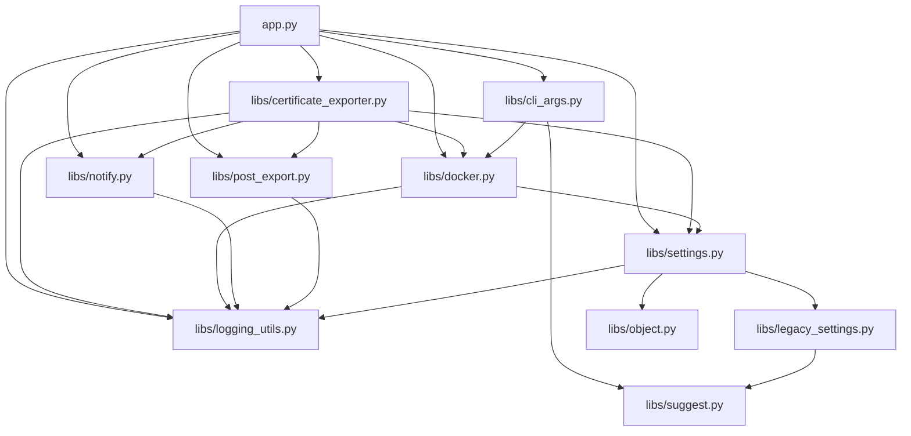
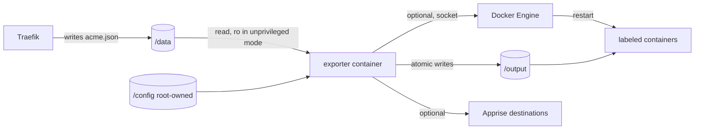

# Architecture Spine — traefik-certificate-exporter

Target: 0.3.0 — describes the intended architecture after epic E014; parts are ahead of the code until E014 lands.

Brownfield: ratifies the shipped codebase plus the decisions recorded for 0.3.0. Every AD is
`[ADOPTED]` — settled by an accepted ADR, a maintainer decision, or existing code.

## Design Paradigm

Layered, single process, no internal service boundaries. The exported files on disk are the
only persistent state.

- **Entrypoint** — `app.py`: strict CLI parse, logging, settings, start-up checks, run-at-start
  pass, watch loop, shutdown.
- **Domain + pass orchestration** — `libs/certificate_exporter.py`: ACME store parsing,
  PEM/PKCS12 build, atomic writes, change detection, artifact mtimes, and the watch handler
  (`AcmeCertificateFileHandler`) that runs a pass (export → hook → notify → restart).
- **Adapters** — `libs/docker.py` (Docker Engine), `libs/post_export.py` (hook subprocess),
  `libs/notify.py` (Apprise), `libs/settings.py` + `libs/legacy_settings.py` (confuse-backed
  config and the settings surface), `libs/cli_args.py` (argparse), `libs/suggest.py`
  (nearest-name helper), `libs/logging_utils.py` (logging, correlation id).
- **Container shell** — `docker/root/`: s6-overlay init oneshot (settings resolution,
  privilege decision, run mode) and the exporter longrun (`run` + `finish`).

External boundaries: the filesystem (`/data` ACME store, `/output` artifacts, `/config`) and,
optionally, the Docker socket and Apprise destinations.

## Invariants & Rules



### AD-1 — Poetry is the single dependency source [ADOPTED]

- **Binds:** `pyproject.toml`, `poetry.lock`, `docker/Dockerfile`, every `src/` import
- **Prevents:** parallel dependency lists; imports that work only transitively; declared
  dependencies nothing imports; a second lockfile tool
- **Rule:** `pyproject.toml` + committed `poetry.lock` are the only declaration of runtime and
  dev dependencies; no other file hand-lists a package set. Exception:
  `.github/requirements/poetry.in`/`poetry.txt` (hash-locked, generated) installs Poetry only in
  CI, per CI AD-11; nothing else. `[tool.poetry.dependencies]` holds exactly what `src/`
  imports, and the locked environment carries no known vulnerability, enforced by the `deptry`
  and `pip-audit` hooks (CI AD-3 owns their scope and exception rules). No module in `src/`
  imports `requests`. `uv.lock` is git-ignored; migrating off Poetry needs a new ADR. — ADR-0001.

### AD-2 — Container base image and privilege model [ADOPTED]

- **Binds:** `docker/Dockerfile`, `docker/root/` (init, service, `privilege-decision.sh`),
  deployment docs
- **Prevents:** a bespoke init/permission scheme; an exporter that drops privileges and then
  cannot read its own ACME store; a root decision taken by a second settings parser
- **Rule:** base on `ghcr.io/linuxserver/baseimage-alpine` (s6-overlay, `PUID`/`PGID`), on a
  supported Alpine line, `FROM` pinned by digest via `ARG BASE_IMAGE`. The service runs as
  **root unless the ACME store is proven readable by the service account**: init pre-writes
  "root", then drops to `abc` only when every check passes, each probed as `abc` through
  `s6-setuidgid` — settings resolved by the installed package; `settings.restartcontainers`
  false; `settings.datapath` listable; at least one `settings.filespec` match; every match
  readable; `settings.outputpath` writable after init takes ownership of it. A missing or
  empty state file reads as root. Anything else keeps root with exactly one init WARNING
  naming the reason, the files and the remedy (run Traefik as the `PUID`/`PGID` user). The
  decision is taken once per container start, lives in the sourced helper
  `privilege-decision.sh`, and is executed by tests. When dropping: ownership walk is
  `find … -xdev ! -type l -exec chown -h` (never `chown -R`), a tmpfs `HOME` owned by `abc`,
  `/config` stays root-owned. Unprivileged mode requires `/data` mounted `:ro`; start-up logs
  one line when the store is writable by `abc`. No setting exists to force either mode. —
  ADR-0002, ADR-0030.

### AD-3 — Logging: structured, correlated, secrets never logged [ADOPTED]

- **Binds:** every logging call site, `logging.yaml`, `libs/logging_utils.py`,
  `libs/settings.py`, `libs/post_export.py`
- **Prevents:** secrets in logs at any level; unparseable file logs; a log config loaded from
  an operator-writable path (code execution via `dictConfig`); log level unsettable in the
  container
- **Rule:** secret-bearing config paths are declared once in `SECRET_CONFIG_KEYS`
  (`pkcs12passphrase`, `appriseurls`, `postexportcommand`) and redaction of every sink
  (settings dump, config dump, raw argparse namespace) derives from that registry via
  `confuse`'s `redact`; a declared-secret list is redacted per element, keeping only the
  `<scheme>://` and the count. Hook log lines name only `argv[0]`. File output is JSON; console
  is `coloredlogs` unless `TRAEFIK_CERTIFICATE_EXPORTER_LOGGING_CONSOLEJSON` selects JSON.
  Logging config comes from the packaged `logging.yaml` or an explicitly set
  `…_LOGGING_CFGFILE`, never a CWD lookup. Level precedence: `-ll` >
  `TRAEFIK_CERTIFICATE_EXPORTER_LOGGING_LEVEL` (case-insensitive) > `INFO`; an invalid value
  gives one WARNING and `INFO`. The `LOGGING_*` env family is read before settings load and
  has no config-file key. Every record carries `correlation_id`: one UUID4 per export pass,
  carried in a `ContextVar` and passed explicitly into the drain timer, deferred-restart
  timers, the hook (`TRAEFIK_CERTIFICATE_EXPORTER_CORRELATION_ID`) and notifications; `-`
  outside a pass. — ADR-0003, ADR-0023, ADR-0014 (Decision 4), E014-S01-004/006/008.

### AD-4 — Docker image built from the locked dependency set [ADOPTED]

- **Binds:** `docker/Dockerfile`, `pyproject.toml`, `poetry.lock`
- **Prevents:** the image's package set diverging from the published package's declared
  dependencies
- **Rule:** a multi-stage build derives runtime dependencies with `poetry install --only main`
  from the committed lock (never `poetry export`, never a hand list); the application itself
  is installed as exactly one caller-supplied, SHA-256-verified wheel with `--no-deps
  --no-index`, `pip check` runs in the build, and pip is removed afterwards. — ADR-0004,
  ADR-0008.

### AD-5 — CI/CD invariants live in the CI/CD spine [ADOPTED]

- **Binds:** `.github/workflows/*`, `justfile`, `.pre-commit-config.yaml`
- **Prevents:** product and pipeline spines stating competing CI rules
- **Rule:** every CI/CD invariant (workflow topology, one hook list for `just check` and CI,
  no `ACT` branching, pinning, publishing, release) is owned by
  `architecture-ci-cd-pipeline-2026-10-08/ARCHITECTURE-SPINE.md` and ADR-0035. Product code
  adds checks only as pre-commit hooks or pytest tests under that spine's AD-3/AD-4; no
  product behaviour branches on CI.

### AD-6 — One settings surface, derived and checked [ADOPTED]

- **Binds:** `config_default.yaml`, `libs/cli_args.py`, `libs/settings.py`,
  `libs/legacy_settings.py`, `libs/suggest.py`, operator docs, `tests/test_settings_surface.py`
- **Prevents:** CLI flags, env names or documented names that nothing reads; silent typos;
  hand-kept name lists drifting from the registry
- **Rule:** `config_default.yaml` is the single key registry; every settings key is declared
  there (optional ones as `null`). Every CLI `dest` beginning `settings.` is a path in it; env
  names are `TRAEFIK_CERTIFICATE_EXPORTER_` + the key path joined by `_` (confuse `EnvSource`
  rule; lists via indexed keys `…_<n>`, never comma-splitting except the existing domain
  lists). Tests derive the dest set, the documented env names (scope from git pathspecs) and
  the confuse mapping — never a hand list. Legacy names live only in `LEGACY_SETTING_NAMES`;
  at start-up each legacy name present (env, config file) gives one WARNING with its
  replacement and is ignored — no aliases; an unknown `TRAEFIK_CERTIFICATE_EXPORTER_*` env name
  gives one WARNING with a `suggest.nearest_name` suggestion; values are never logged. A file
  that quotes legacy names must carry `tce-settings-scan: legacy-names-listed` and at least one
  legacy name. `settings.domains.include` and `settings.domains.exclude` are mutually
  exclusive across every surface (CLI, environment, config file): both set, from any
  combination of surfaces, logs one ERROR and exits 1. Production argv is parsed strictly in `main()` (unknown flag → exit 2 with
  `Did you mean …?` from `suggest.nearest_name` and a `--help` pointer); the import-time
  `globalArgs` stays lenient. Every value-taking flag has a `metavar` without a `.`. — ADR-0025,
  E014-S01-004, E014-S01-008.

### AD-7 — ACME store parsing is shape-based, CA-agnostic and isolated per resolver [ADOPTED]

- **Binds:** `libs/certificate_exporter.py` (parsing helpers, `exportCertificatesForFile`)
- **Prevents:** non-Let's-Encrypt stores rejected; one null or broken resolver discarding
  others' results; empty keys written from bad base64
- **Rule:** detect store shape by keys, never by registration URI: a resolver node is a dict
  with `Certificates` or `Account` (either case); a v1.7 single store is a top-level resolver
  node; legacy certificates come from `DomainsCertificate.Certs`. Null `Certificates`,
  `Account`, `Registration` or missing `uri` are empty, not errors. Key case is chosen per
  certificate entry. Each resolver runs in its own `try` (one ERROR, then continue); a
  non-resolver top-level key is skipped with a WARNING. Base64 is decoded with
  `validate=True`; a bad field fails only that certificate. `exportCertificatesForFile`
  returns `list[str]`, never `None`. No store size cap. `traefikresolverid` limits processing
  to that node. Parsing is stdlib `json`/`base64`; no schema validator. — E014-S01-003.

### AD-8 — Export artifacts: build first, write atomically, rewrite only on change [ADOPTED]

- **Binds:** `libs/certificate_exporter.py` (`PemToPfxConverter`, `__exportCertificate`,
  `_atomic_write*`, `artifactMtime`)
- **Prevents:** half-rotated domains; truncated files; broken PFX when a passphrase is set;
  "changed" signals and mtimes moving when nothing changed
- **Rule:** every domain yields the PEM set (key, cert, chain, fullchain) and a PKCS12. All
  decoding, chain parsing (`x509.load_pem_x509_certificates`) and PKCS12 serialisation for a
  domain complete before its first write; a build failure leaves its existing files untouched
  and the domain unreported. The private key is loaded unencrypted; the passphrase is used only
  to encrypt the `.pfx` (`BestAvailableEncryption`; `None`/`""` means unencrypted); the PFX
  carries the intermediates in input order. Each artifact is compared with the file on disk
  (PEM by bytes; PFX by key, leaf, intermediates and encryption state) and only changed
  artifacts are written, each via same-directory temp file + `os.replace` (PEM and `.pfx`
  alike); key and `.pfx` are mode 0600. A domain is reported (the changed signal) iff at least
  one artifact was replaced in the pass. No state file or fingerprint store exists besides the
  exported files. Dry run builds and compares in memory and writes nothing. — ADR-0023,
  ADR-0024, memlog 2026-10-11, E014-S01-002.

### AD-9 — Pass sequence and consumer contracts [ADOPTED]

- **Binds:** `app.py` (run-at-start pass), `AcmeCertificateFileHandler` (watch pass),
  `libs/post_export.py`, `libs/notify.py`
- **Prevents:** hooks and notifications firing on every pass; a consumer failure aborting an
  export; the two call paths diverging
- **Rule:** a pass is export → post-export hook → notifications → restart evaluation, on both
  call paths. The hook and notifications run only when the changed-domain list is non-empty
  and receive exactly that list. The hook is a subprocess with a fixed 30 s timeout; failure is
  logged, never propagated. Notifications are Apprise (ordinary runtime dependency), fired at
  `post-export` only, fire-and-forget, bounded by Apprise's per-destination timeouts; there is
  no event bus and no `pre-export`/`cert-export` event. Restart evaluation runs on every pass
  regardless of changes (AD-10). In dry run the hook and notifications are skipped with one
  INFO line each. — ADR-0014, E014-S01-006.

### AD-10 — Container restart: one client, file-mtime trigger, defer not drop [ADOPTED]

- **Binds:** `libs/docker.py`, both pass call sites, `app.py` start-up
- **Prevents:** a restart path that cannot reach the Engine; a planted `~/.docker` context
  redirecting restarts; restarts on unchanged certificates; renewals lost to the cooldown
- **Rule:** the Docker SDK client is built only by `DockerManager._create_client()` via
  `docker.from_env(use_context=False)`; the Engine must offer API 1.24 or newer (the docker
  SDK 7.x floor), and an older Engine surfaces as the start-up reachability ERROR. When `settings.restartcontainers` is true, start-up
  pings once and logs reachability; failure logs ERROR and export continues. Candidates are
  containers labeled `com.github.ravensorb.traefik-certificate-exporter.domain-restart`
  (comma-separated domains). A candidate is restarted iff the newest mtime of its domains'
  exported artifacts exceeds its `State.StartedAt` (UTC, `dateutil` `isoparse`) by more than
  `RESTART_MTIME_SLACK_SECONDS` = 2; missing, empty, unparsable or zero `StartedAt` means no
  restart. A per-container `RESTART_COOLDOWN_SECONDS` = 300 floor applies; a restart the floor
  denies arms one coalesced daemon timer, which re-checks label and rule against a fresh client
  at fire time. Failures log ERROR without re-arming; the next pass recovers by the same rule.
  `DockerManager.cancel()` clears pending timers on every exit path. Window and slack are not
  configurable; no restart state is persisted. Engine errors are caught as `DockerException`
  and `OSError`. Dry run logs intended restarts and arms nothing. — memlog 2026-10-11,
  E014-S01-001, E014-S01-006.

### AD-11 — Watch, debounce and shutdown [ADOPTED]

- **Binds:** `AcmeCertificateFileHandler`, `app.py` signal handling
- **Prevents:** shutdown blocked past `docker stop`'s grace; a new pass starting after
  shutdown begins; `None`-timer crashes
- **Rule:** filesystem events arm one 2 s drain timer per window (coalesced). Drain threads
  are daemons. SIGTERM and SIGINT both enter one shutdown path that calls the handler's
  None-safe `cancel()`: cancel an armed timer, wait at most `SHUTDOWN_JOIN_TIMEOUT_SECONDS`
  (5 s) for an in-flight drain, latch a shutdown flag, then exit. Abandoning a drain is safe
  only because writes are atomic (AD-8). — ADR-0023, ADR-0026.

### AD-12 — Container service lifecycle: one resolver, run-once or watch [ADOPTED]

- **Binds:** `docker/root/etc/s6-overlay/s6-rc.d/*`, `docker/root/usr/local/lib/…`,
  `docker/root/defaults/`, `app.py` (run selection), `.pre-commit-config.yaml`
- **Prevents:** shell scripts re-parsing settings with their own truthiness; run-once
  respawned forever by s6; a configuration that silently does nothing; a first boot with no
  config file
- **Rule:** the init oneshot resolves settings once through the installed package
  (`SettingsManager`) and writes state files under `/run/traefik-certificate-exporter/`
  atomically (`run-as-root`, `resolved-settings`, `watch-for-changes` = `true`|`false`). No
  script under `docker/root/` reads a `TRAEFIK_CERTIFICATE_EXPORTER_SETTINGS_*` env var
  (pygrep hook `s6-no-raw-settings-env`); shell scripts pass ShellCheck (SHA-frozen
  `shellcheck` hook); both hooks are in CI AD-3's hook list. The service always
  execs the exporter through the privilege branch. A `finish` script exits 0 in watch mode (s6
  respawns); in run-once mode it writes the exit code to
  `/run/s6-linux-init-container-results/exitcode` and halts the container. A missing or
  invalid mode file means watch. The exit code reflects start-up failures only.
  The image keeps `settings.runatstart` on by default (`Dockerfile` env and the seeded sample;
  the start-up pass produces the first export); when both it and `settings.watchforchanges`
  are false, the app logs one WARNING that there is nothing to do and returns normally. On first boot the init oneshot seeds
  `/config/config.yaml` from `/defaults/config/config.yaml.sample` when the file is absent and
  never overwrites an existing one. — ADR-0030, E014-S01-005, E014-S01-006.

### AD-13 — Module layering as built [ADOPTED]

- **Binds:** `src/traefik_certificate_exporter/**`
- **Prevents:** import cycles; adapters reaching back into the domain or entrypoint
- **Rule:** imports follow the diagram above. `logging_utils` imports nothing in-package;
  `suggest` and `object` import nothing in-package; adapters (`docker`, `notify`,
  `post_export`) never import `certificate_exporter` or `app`. `certificate_exporter` hosts the
  watch handler and orchestrates the adapters for the watch pass; `app` orchestrates the
  run-at-start pass. New modules join the adapter layer unless they orchestrate a pass. —
  review-product M7.

## Consistency Conventions

| Concern | Convention |
| --- | --- |
| Naming (config, CLI, env) | Lowercase-dotted keys (`settings.datapath`); CLI `dest=` is the dotted key; env `TRAEFIK_CERTIFICATE_EXPORTER_` + key path with `_`; docs show placeholders ending in `_` (`…_SETTINGS_<KEY>`) (AD-6) |
| Naming (code) | `libs/docker.py`, `certificate_exporter.py` classes use `camelCase` methods; module-level private helpers are `_snake_case`; tests for `libs/x.py` live in `tests/libs/test_x.py`; repository-wide checks live at `tests/` top level |
| Data & formats — artifacts | Per-domain layout `privkey.pem/cert.pem/chain.pem/fullchain.pem/cert.pfx`; flat layout `<name>.key/.crt/.chain.pem/.fullchain.pem/.pfx` (flat `.crt` holds the full chain); `fullchain.pem` is the store bytes unchanged; SANs are logged, not exported |
| Data & formats — signals | The changed-domain list is the only change signal; restarts read artifact mtimes vs container `StartedAt`; the files are the state (AD-8, AD-10) |
| State & cross-cutting | Precedence CLI > env > config file > packaged default (`confuse`); global singletons (`globalLogger`, `globalArgs`, `globalSettingsMgr`) for cross-cutting concerns, no DI; secrets per AD-3 |
| Errors | Per-certificate and per-resolver failures log one ERROR and continue; consumer (hook, notify, restart) failures never abort a pass; start-up misconfiguration (missing data path, unknown flag) fails loudly |
| Testing | pytest only; real integration seams opt-in via `@pytest.mark.integration` and `TCE_DOCKER_INTEGRATION=1`; image tests target `${TCE_IMAGE:-traefik-certificate-exporter:local}`; fixtures use synthetic domains and the shared `real_chain()` generator |
| Repository framing | "Not maintained by us" framing of vendored `.agents/`/`.claude/` trees lives only in `.github/CODEOWNERS` (ADR-0027) |

## Stack

| Name | Version |
| --- | --- |
| Python | `>=3.10,<3.15` |
| Poetry | dependency/build tool (AD-1), lock committed |
| watchdog | `^6.0` |
| docker (SDK) | `^7.2`, `from_env(use_context=False)` |
| confuse | `^2.0.1` |
| cryptography | `^50.0.2` |
| pyyaml | `^6.0` (main group) |
| python-dotenv | `^1.2.2` |
| python-dateutil | `^2.9.0` |
| apprise | `^1.9` |
| coloredlogs | `^15.0.1` |
| python-json-logger | `^4.2.0` |
| deptry, pip-audit | dev group, locked in `poetry.lock` |
| `ghcr.io/linuxserver/baseimage-alpine` | `3.24`, digest-pinned in `docker/Dockerfile` `ARG BASE_IMAGE` |
| s6-overlay | `3.2.1.0` (from the base image) |

## Structural Seed

```text
src/traefik_certificate_exporter/
  app.py                     # entrypoint: strict parse, logging, start-up checks, run-at-start pass, watch loop
  config_default.yaml        # single settings key registry (AD-6)
  logging.yaml               # packaged dictConfig source
  libs/
    certificate_exporter.py  # parsing, PEM/PKCS12 build, atomic writes, change detection, watch handler
    docker.py                # DockerManager: client factory, restart rule, cooldown/deferral
    post_export.py           # post-export hook subprocess
    notify.py                # Apprise notifications
    settings.py              # Settings + SettingsManager, secret registry, redaction
    legacy_settings.py       # LEGACY_SETTING_NAMES, valid env names, start-up warnings
    suggest.py               # nearest_name (difflib)
    cli_args.py              # argparse surface, strict parse
    logging_utils.py         # setup_logging, correlation id factory
    object.py                # ObjectBase pub/sub used by SettingsManager
docker/
  Dockerfile                 # multi-stage; locked deps + verified wheel (AD-4)
  root/etc/s6-overlay/s6-rc.d/
    init-traefik-certificate-exporter-config/   # resolves settings, privilege, run mode
    svc-traefik-certificate-exporter/           # run + finish
  root/usr/local/lib/traefik-certificate-exporter/privilege-decision.sh
tests/                       # pytest; libs/ unit tests, top-level surface and s6 tests, opt-in integration tests
```



## Capability → Architecture Map

| Capability / Area | Lives in | Governed by |
| --- | --- | --- |
| FR-1 ACME parsing (v1, v1.7, v2/v3, any CA) | `libs/certificate_exporter.py` | AD-7 |
| FR-2 PEM + PKCS12 export | `libs/certificate_exporter.py` (`PemToPfxConverter`, `__exportCertificate`) | AD-8 |
| FR-3 flat / per-domain layouts | `libs/certificate_exporter.py` | AD-8, Conventions (artifacts) |
| FR-4 domain include/exclude | `libs/settings.py`, `libs/cli_args.py` | AD-6 |
| FR-5 resolver scoping / auto-detect | `libs/certificate_exporter.py` | AD-7 |
| FR-6 run-once / watch | `app.py`; s6 init mode file, service `run`/`finish` | AD-11, AD-12 |
| FR-7 event debounce | `AcmeCertificateFileHandler` in `libs/certificate_exporter.py` | AD-11, AD-13 |
| FR-8 Docker restart of labeled containers | `libs/docker.py`, both pass call sites | AD-9, AD-10 |
| FR-9 dry run | exporter, `docker.py`, `post_export.py`, `notify.py` | AD-8, AD-10 |
| FR-10 CLI / file / env config | `config_default.yaml`, `libs/settings.py`, `libs/cli_args.py`, `libs/legacy_settings.py` | AD-6, Conventions (naming) |
| FR-11 PyPI + Docker distribution | `pyproject.toml`, `docker/Dockerfile`, `docker/root/` | AD-1, AD-2, AD-4, AD-5 |
| FR-12 post-export hook (changed domains only) | `libs/post_export.py`, both pass call sites | AD-9, AD-3 |
| FR-13 notifications (changed domains only) | `libs/notify.py`, both pass call sites | AD-9, AD-3 |
| FR-14 PKCS12 passphrase and chain | `libs/certificate_exporter.py` (`PemToPfxConverter`) | AD-8 |
| FR-15 restart trigger (artifact mtime vs `StartedAt`) | `libs/docker.py`, `artifactMtime` | AD-10 |
| FR-16 legacy and unknown setting names | `libs/legacy_settings.py`, `libs/suggest.py` | AD-6 |
| FR-17 release publishing to configured destinations | `.github/workflows/*` | AD-5 → CI spine AD-8, AD-9, AD-12, AD-13 |
| NFR-1 no secret leakage | `libs/settings.py`, `libs/post_export.py`, `logging_utils.py` | AD-3 |
| NFR-2 loud misconfiguration | `app.py`, `libs/cli_args.py`, `libs/legacy_settings.py` | AD-6, Conventions (errors) |
| NFR-3 installable, no missing deps | `pyproject.toml`, `poetry.lock` | AD-1, AD-4 |
| NFR-4 CI builds and publishes | `.github/workflows/*`, `justfile` | AD-5 |
| NFR-5 regression suite | `tests/` | Conventions (testing), AD-5 |
| NFR-6 structured, traceable logs | `libs/logging_utils.py`, `logging.yaml` | AD-3 |
| NFR-7 working first-run config | s6 init oneshot, `docker/root/defaults/` | AD-2, AD-12 |

## Deferred

- **Metrics / health surface and `HEALTHCHECK`** (PRD #21, review m10) — needs stakeholder
  validation before it becomes an AD.
- **Exit code that reflects export failures** (PRD #23) — run-once signals start-up failures
  only until a contract is decided.
- **SANs export** (PRD #22) — SANs are logged, not exported; revisit on a concrete request.
- **Module extraction** (review M7, m6) — moving the watch handler and pass sequence into an
  orchestration module, `_atomic_write*` into an I/O module, and one shared pass helper; AD-13
  records the current layering until that is decided.
- **Output parent-directory symlink hardening** (review m5) — leaf replacement is safe; a
  swapped parent directory is not yet covered.
- **Additional events** (`pre-export`, `cert-export`) and checked HTTP actions — unrequested;
  the flat shape of AD-9 keeps them addable.
- **`pkcs12legacy` (3DES/SHA1) output, Apprise 2.x, non-`default` `CertAndStore.Store`
  values, nearest-name suggestions for unknown config-file keys, argparse output through the
  structured logger** — unrequested or out of scope for 0.3.0.
- **Kubernetes-native deployment and multi-instance coordination** — out of scope per PRD §5.
- **Cross-process correlation id** — revisit only if a network-facing component is added.
- **Clock skew beyond 2 s and remote Docker daemons** — unsupported for the restart rule.
- **Notification-delivery failure visibility** (PRD NFR-6, BL-E011-017) — delivery failures
  stay invisible while third-party loggers are suppressed; open until that backlog item is
  decided.

## Changelog

- Consolidated 2026-10-11 from ADR-0001, ADR-0002, ADR-0003, ADR-0004 (with ADR-0008), ADR-0013 (via ADR-0014), ADR-0014, ADR-0023, ADR-0024, ADR-0025, ADR-0026, ADR-0027, ADR-0030 (incl. 2026-10-10 privilege decision); memlog entries "spine authored" (2026-08-30), "AD-4 mechanism poetry install --only main", "restart only on change" (2026-10-11); E014 stories E014-S01-001, E014-S01-002, E014-S01-003, E014-S01-004, E014-S01-005, E014-S01-006, E014-S01-007, E014-S01-008; review-product.md (2026-10-10) AD table, M7, M8.
- 2026-10-11 baseline cross-check (`epic-014/plan-review/review-baseline-consistency.md`): `target` key; `binds:` and Capability map extended to FR-12..FR-17; AD-1 Poetry bootstrap exception (CI AD-11) and hook mechanics deferred to CI AD-3; AD-6 include/exclude exclusivity; AD-9 dry-run skip; AD-10 Engine API 1.24 floor; AD-12 `runatstart` default, nothing-to-do WARNING, first-boot config seed, ShellCheck and `s6-no-raw-settings-env` routed to CI AD-3; Deferred BL-E011-017.
