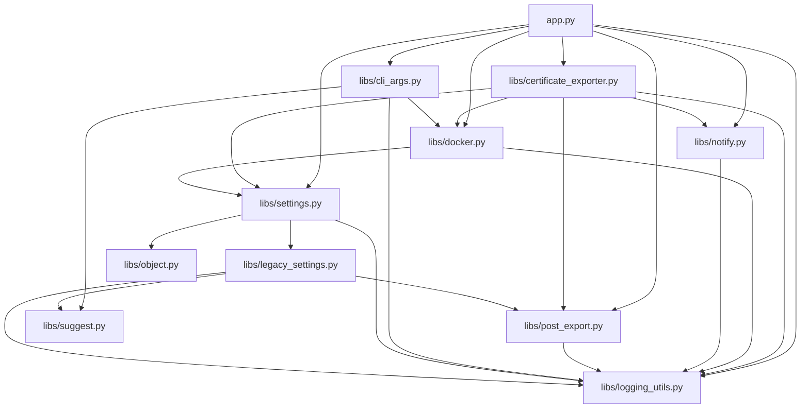
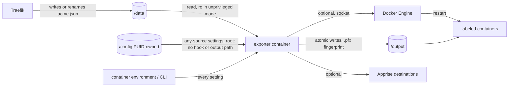

# Architecture Spine — traefik-certificate-exporter

Target: 0.3.1 — describes the intended architecture after epic E015; parts are ahead of the code until E015 lands.

Brownfield: ratifies the released 0.3.0 codebase plus the decisions recorded for 0.3.1. Every
AD is `[ADOPTED]` — settled by an accepted ADR, a maintainer decision, or existing code. Where
a rule needs an ADR that does not exist yet, the AD names the E015 story that writes it.

## Design Paradigm

Layered, single process, no internal service boundaries. The exported files on disk are the
only persistent state, plus one fingerprint file per `.pfx` used only to decide whether that
`.pfx` is current (AD-8).

- **Entrypoint** — `app.py`: strict CLI parse, logging, settings, start-up checks, run-at-start
  pass, watch loop, shutdown.
- **Domain + pass orchestration** — `libs/certificate_exporter.py`: ACME store parsing,
  PEM/PKCS12 build, atomic writes, change detection, artifact mtimes, and the watch handler
  (`AcmeCertificateFileHandler`) that runs a pass (export → hook → notify → restart). This
  shape is accepted and its extraction is planned work (ADR-0048).
- **Adapters** — `libs/docker.py` (Docker Engine), `libs/post_export.py` (hook subprocess),
  `libs/notify.py` (Apprise), `libs/settings.py` + `libs/legacy_settings.py` (confuse-backed
  config, the settings surface and the root-mode trust rule), `libs/cli_args.py` (argparse),
  `libs/suggest.py` (nearest-name helper), `libs/logging_utils.py` (logging, correlation id).
- **Container shell** — `docker/root/`: s6-overlay init oneshot (settings resolution,
  privilege decision, run mode) and the exporter longrun (`run` + `finish`), on top of the
  unchanged LinuxServer base init.

External boundaries: the filesystem (`/data` ACME store, `/output` artifacts, `/config` owned
by `PUID`/`PGID`) and, optionally, the Docker socket and Apprise destinations.

## Invariants & Rules



### AD-1 — Poetry is the single dependency source [ADOPTED]

- **Binds:** `pyproject.toml`, `poetry.lock`, `docker/Dockerfile`, every `src/` import
- **Prevents:** parallel dependency lists; imports that work only transitively; declared
  dependencies nothing imports; a second lockfile tool
- **Rule:** `pyproject.toml` + committed `poetry.lock` are the only declaration of runtime and
  dev dependencies; no other file hand-lists a package set. This includes the tools pre-commit
  hooks run in the build job (mypy, import-linter and the type stubs are dev-group packages;
  CI AD-3). Exception: `.github/requirements/poetry.in`/`poetry.txt` (hash-locked, generated)
  installs Poetry only in CI, per CI AD-11; nothing else. `[tool.poetry.dependencies]` holds
  exactly what `src/` imports, and the locked environment carries no known vulnerability,
  enforced by the `deptry` and `pip-audit` hooks (CI AD-3 owns their scope and exception
  rules). No module in `src/` imports `requests`. `uv.lock` is git-ignored; migrating off
  Poetry needs a new ADR. — ADR-0001, ADR-0046 (bootstrap exception), E015-S02-003.

### AD-2 — Container base image, privilege model and root-mode settings trust [ADOPTED]

- **Binds:** `docker/Dockerfile`, `docker/root/` (init, service, `privilege-decision.sh`),
  `libs/settings.py` (`ROOT_SETTING_TRUST`, root-mode withholding, `filespec` validation,
  `sourceOf`), `app.py` (hook-source line), `pyproject.toml` (ruff `TID251` banned-api),
  `tests/test_settings_surface.py`, `tests/libs/test_settings.py`,
  `tests/libs/test_post_export.py`, `tests/test_container_root_trust.py`, deployment docs
- **Prevents:** a bespoke init/permission scheme; breaking LinuxServer's ownership
  conventions; an exporter that drops privileges and then cannot read its own ACME store; a
  root decision taken by a second settings parser; a file writable by the service account
  choosing what a root process executes, where it writes, or which store it trusts as the
  source of what it writes
- **Rule:**
  - **Base and LinuxServer conventions.** Base on `ghcr.io/linuxserver/baseimage-alpine`
    (s6-overlay, `PUID`/`PGID`), on a supported Alpine line, `FROM` pinned by digest via
    `ARG BASE_IMAGE`. The base init is kept as LinuxServer ships it: `init-adduser` gives
    `/app`, `/config` and `/defaults` to `abc` (`PUID`/`PGID`) on every start, and nothing
    disables, patches or works around it. `/config` is never taken back to root and an
    `abc`-owned config is never refused; host operators edit `config.yaml` as their `PUID`
    user. ADR-0030's paragraph that `/config` stays root-owned did not describe what ships and
    is amended by E015-S01-001.
  - **Privilege decision.** The service runs as **root unless the ACME store is proven
    readable by the service account**: init pre-writes "root", then drops to `abc` only when
    every check passes, each probed as `abc` through `s6-setuidgid` — settings resolved by the
    installed package; `settings.restartcontainers` false; `settings.datapath` listable; at
    least one `settings.filespec` match; every match readable; `settings.outputpath` writable
    after init takes ownership of it. A missing or empty state file reads as root. Anything
    else keeps root with exactly one init WARNING naming the reason, the files and the remedy
    (run Traefik as the `PUID`/`PGID` user). The decision is taken once per container start,
    lives in the sourced helper `privilege-decision.sh`, and is executed by tests. When
    dropping: ownership walk is `find … -xdev ! -type l -exec chown -h` (never `chown -R`), and
    a tmpfs `HOME` owned by `abc`. Both modes require `/data` mounted `:ro`: in either mode the
    store and its directory must not be writable by `PUID` (ADR-0049, AR-1). Start-up logs one
    line when the store is writable by `abc`, today only when no earlier row decided (row 2,
    `restartcontainers`, returns first; BL-E015-004, Deferred). No setting exists to force either mode.
  - **Root-mode settings trust.** A process whose euid is 0 takes every
    `environment-only-when-root` setting only from the environment, the command line or the
    packaged default. After all sources are merged, `SettingsManager.loadFromFile` reads each
    such key's confuse `resolve()` pairs; when the winning pair comes from a file source (a
    confuse source with a filename that is not the packaged default: the config file and the
    confuse user config), the value is withheld by removing that key from every file source
    in confuse's own source list (`RootView.sources`), never by `set()`, which would add a
    filename-less overlay indistinguishable from the command line. confuse's `resolve()`
    then yields the next admissible source with its real source object, so `sourceOf`
    reports `environment`, `command line` or `default` accurately (verified against confuse
    2.3.0, E015-S01-001). A `.env` file is a file source: in root mode it may contribute only the environment
    variable names of `any-source` settings (derived from the trust table through
    `_env_name`, compared case-insensitively). Every other name `load_dotenv` newly adds is
    removed: an environment-only key (reported below), and anything else (`LOGGING_*`,
    `LD_PRELOAD`, `DOCKER_HOST`, …), reported in one ERROR per `.env` file that lists the
    removed names, never values (ADR-0049 amendment 2026-10-12); a removed legacy name
    (AD-6) is left out of that ERROR and reported once by the AD-6 legacy WARNING with its
    replacement (E015-S01-004). A variable the real
    environment already held is kept. Each withheld key gives one start-up ERROR naming the
    setting, the file and the `TRAEFIK_CERTIFICATE_EXPORTER_SETTINGS_*` name to use, never the
    value; exporting continues (no exit). The rule is inactive when the euid is not 0 or
    `os.geteuid` does not exist. It applies to the init resolver too, which runs as root
    through the same `loadFromFile`, so the `outputpath` init chowns in dropped mode never
    comes from a file. This is a trust rule over admissible sources, not a change to the
    precedence of AD-6.
  - **`filespec` is a file-name glob inside `datapath`, in every mode.** Validated once in
    `SettingsManager.loadFromFile` on the pattern text, for every source and every euid: an
    empty value, a `/` or `\` (every platform), exactly `.` or `..`, an absolute value or a
    drive is rejected with one ERROR naming `settings.filespec` and its source (never the
    value), and the packaged default `*.json` is used. The export pass, the watcher and the
    init resolver all read this one validated value, so no s6 script changes. A caller that
    constructs `Settings` directly is trusted and not validated.
  - **Trust classes.** `ROOT_SETTING_TRUST` in `libs/settings.py`, beside
    `SECRET_CONFIG_KEYS`, maps every leaf key path of `config_default.yaml` to one class:

    | Class | Keys | Why |
    | --- | --- | --- |
    | `environment-only-when-root` | `postexportcommand` | root executes it |
    | `environment-only-when-root` | `outputpath` | root writes there; init chowns under it in dropped mode |
    | `environment-only-when-root` | `datapath` | root trusts the store it reads there as the source of what it writes |
    | `any-source` | `filespec` | validated at load as a file-name glob, so it cannot leave `datapath` |
    | `any-source` | `traefikresolverid`, `resolverinpathname`, `flat`, `domains.include`, `domains.exclude` | path components whitelisted, containment checked |
    | `any-source` | `restartcontainers` | `docker.py` only pings, lists by label, gets and restarts labelled containers; endpoint from `DOCKER_HOST` only |
    | `any-source` | `appriseurls` | network egress only; Apprise loads no plugins and reads no local attachment |
    | `any-source` | `pkcs12passphrase`, `dryrun`, `watchforchanges`, `runatstart`, `watchinterval`, `validatekeys` | availability only, no read/write/execute reach |

    The class rule: a setting whose value root executes, writes to, or trusts as the source
    of what it writes is environment-only when root, unless it is validated at load so that
    it cannot leave an environment-only path (ADR-0049). Logging configuration is already environment-only (the `LOGGING_*` family has
    no file key, AD-3). Enforcement, scope derived from the source of truth: a surface test
    derives the leaf set from `config_default.yaml` and fails on an unclassified leaf, a
    non-leaf entry or an unknown class, and a companion test proves it reports a planted
    leaf; a loader test records every file the loader opens (config file, confuse user config,
    cwd and module `.env`) and proves a root load ignores the hook from each; unit tests reject
    each invalid `filespec` form and withhold a file-sourced `datapath` as root; ruff `TID251`
    banned-api makes `libs/post_export.py` the only process-spawn site (ADR-0050: the
    spawn-capable `os` names are derived from `dir(os)` and checked against the banned table,
    and a planted `os.posix_spawn` and literal `subprocess.run` fail the hook; dynamic access
    through `getattr`/`importlib`/`__import__` is not covered); an opt-in image test replays
    RT-1 (a `PUID` rename of `config.yaml` carrying `restartcontainers: true` and a hook) and
    proves the hook does not run, replays the forged-store attack (a `PUID`-written
    `/config/forged.json` named by `filespec` in `config.yaml`) and proves the genuine
    `/certs` key is untouched, and proves that an environment hook still runs as root, that a
    `config.yaml` hook runs as `PUID` in dropped mode, and that `/config` stays
    `PUID`-owned and editable. **Not mechanically checked:** the `any-source` rationales in
    the table are reviewed claims; no test proves an `any-source` key cannot change what root
    executes or where or what it writes. Review trigger: a new key, or a change to how an
    existing key is used in `certificate_exporter.py`, `docker.py`, `notify.py` or the init
    resolver.
  - **Hook opt-in.** Setting the hook in the environment or on the command line is the opt-in
    for a root hook; it runs with the exporter's uid. There is no flag to re-admit a
    file-sourced root hook and the hook is never re-run as `abc` by a root exporter. A dropped
    exporter runs a `config.yaml` hook as `abc`.
  - **Residual risks, documented not enforced:** a `PUID`-writable store directory in root
    mode gives the same reach as a file-chosen store (AR-1; `/data:ro` required in both
    modes); an environment-set root hook that runs a program or script stored in `/config`;
    `…_LOGGING_CFGFILE` pointed into `/config`; Docker mods and `/custom-cont-init.d`; the venv
    under the `abc`-owned `/app` (BL-E015-002, Deferred).

  — ADR-0002, ADR-0030 (amended by E015-S01-001 to point to ADR-0049), ADR-0049 (root-mode
  settings trust: hook, output path and store location), ADR-0050 (spawn-site guard),
  maintainer decisions MD-19 to MD-23 (2026-10-12; MD-21 extended 2026-10-12 by the AG-1
  resolution), E015-S01-001.

### AD-3 — Logging: structured, correlated, secrets never logged [ADOPTED]

- **Binds:** every logging call site, `logging.yaml`, `libs/logging_utils.py`,
  `libs/settings.py`, `libs/post_export.py`, `app.py`
- **Prevents:** secrets in logs at any level; unparseable file logs; a log config loaded from
  an operator-writable path (code execution via `dictConfig`); log level unsettable in the
  container
- **Rule:** secret-bearing config paths are declared once in `SECRET_CONFIG_KEYS`
  (`pkcs12passphrase`, `appriseurls`, `postexportcommand`) and redaction of every sink
  derives from that registry: the config dump via `confuse`'s `redact`, the settings dump
  and the raw argparse namespace via `settings._redact_secrets`; redaction is value-aware (an
  unset secret renders `null`) and a declared-secret list is redacted per element, keeping
  only the `<scheme>://` and the count. Hook log lines name only the program (`argv[0]`),
  never its arguments or the command string, and a hook parse failure names neither the
  command nor the parser message. File output is JSON; console
  is `coloredlogs` unless `TRAEFIK_CERTIFICATE_EXPORTER_LOGGING_CONSOLEJSON` selects JSON.
  Logging config comes from the packaged `logging.yaml` or an explicitly set
  `…_LOGGING_CFGFILE`, never a CWD lookup. Level precedence: `-ll` >
  `TRAEFIK_CERTIFICATE_EXPORTER_LOGGING_LEVEL` (case-insensitive; one pair of surrounding
  quotes stripped; empty counts as unset) > `INFO`; an invalid value gives one WARNING
  (variable, sanitized value, allowed set) and `INFO`, never an exit, and one INFO line at
  start-up names the effective level and its source (`cli`, `env`, `default`). The `LOGGING_*` env family is read before settings load and
  has no config-file key. Start-up also logs, after `Output Path`, one INFO
  `Post-export command: <set|not set> (source: <environment|command line|configuration file '<path>'|default>), runs as uid <euid>`
  (`n/a` without `os.geteuid`; the command is never logged) and one INFO
  `RSA key validation: on` or `RSA key validation: off (…)` (not a WARNING: the operator chose
  it); the root-mode withholding ERROR (AD-2) names setting and file, never the value. Every record carries `correlation_id`: one UUID4 per export pass,
  carried in a `ContextVar` and passed explicitly into the drain timer, deferred-restart
  timers, the hook (`TRAEFIK_CERTIFICATE_EXPORTER_CORRELATION_ID`) and notifications; `-`
  outside a pass. — ADR-0003, ADR-0023, ADR-0014 (Decision 4), ADR-0045 (decision 14),
  E014-S01-004/006/008/010, E015-S01-001, E015-S01-002.

### AD-4 — Docker image built from the locked dependency set [ADOPTED]

- **Binds:** `docker/Dockerfile`, `pyproject.toml`, `poetry.lock`
- **Prevents:** the image's package set diverging from the published package's declared
  dependencies
- **Rule:** a multi-stage build derives runtime dependencies with `poetry install --only main`
  from the committed lock (never `poetry export`, never a hand list); the application itself
  is installed as exactly one caller-supplied, SHA-256-verified wheel with `--no-deps
  --no-index`, `pip check` runs in the build, and pip is removed afterwards. The venv stays at
  `/app/.venv` for 0.3.1 (moving it to `/lsiopy` is BL-E015-002, Deferred). — ADR-0004,
  ADR-0008.

### AD-5 — CI/CD invariants live in the CI/CD spine [ADOPTED]

- **Binds:** `.github/workflows/*`, `justfile`, `.pre-commit-config.yaml`
- **Prevents:** product and pipeline spines stating competing CI rules
- **Rule:** every CI/CD invariant (workflow topology, one hook list for `just check` and CI,
  locked hook dependencies, no `ACT` branching, pinning, publishing, release) is owned by
  `architecture-ci-cd-pipeline-2026-10-08/ARCHITECTURE-SPINE.md` and ADR-0035. Product code
  adds checks only as pre-commit hooks or pytest tests under that spine's AD-3/AD-4; no
  product behaviour branches on CI.

### AD-6 — One settings surface, derived and checked [ADOPTED]

- **Binds:** `config_default.yaml`, `libs/cli_args.py`, `libs/settings.py`,
  `libs/legacy_settings.py`, `libs/suggest.py`, operator docs, `tests/test_settings_surface.py`
- **Prevents:** CLI flags, env names or documented names that nothing reads; silent typos;
  hand-kept name lists drifting from the registry; a historical name that operators were told
  to set and that is silently ignored
- **Rule:** `config_default.yaml` is the single key registry; every settings key is declared
  there (optional ones as `null`), and every leaf has a root-trust class in
  `ROOT_SETTING_TRUST` (AD-2). Every CLI `dest` beginning `settings.` is a path in it; env
  names are `TRAEFIK_CERTIFICATE_EXPORTER_` + the key path joined by `_` (confuse `EnvSource`
  rule; lists via indexed keys `…_<n>`, never comma-splitting except the existing domain
  lists). Precedence is `CLI > env > config file > packaged default` for every setting; the
  root-mode trust rule (AD-2) removes file sources from the admissible set for three keys
  (`postexportcommand`, `outputpath`, `datapath`) when the euid is 0 and does not reorder the
  rest. `settings.filespec` is validated at load as a file-name glob in every mode; an invalid
  value from any source falls back to the packaged default with one ERROR (ADR-0049). A boolean opt-out flag uses
  `action="store_const"`, `const=False`, `default=None`, so an absent flag never overrides env
  or file (`--no-validate-keys` → `settings.validatekeys`). Tests derive the dest set, the
  documented env names (scope from git pathspecs) and
  the confuse mapping — never a hand list. Legacy names live only in `LEGACY_SETTING_NAMES`;
  at start-up each legacy name present (env, config file) gives one WARNING with its
  replacement (or a hint when nothing replaces it) and is ignored — no aliases. The table
  includes the eleven environment names the 0.0.x image's `docker/root/app/run.sh` translated
  into flags (v0.0.2–v0.0.9.2; ignored since v0.0.10.0); a name outside the
  `TRAEFIK_CERTIFICATE_EXPORTER_` prefix is matched exactly and case-sensitively against
  those rows only, is never reported as unknown and never offered to `suggest.nearest_name`,
  so Traefik's own `TRAEFIK_*` variables, `PUID`, `TZ` and the rest produce nothing. An
  unknown `TRAEFIK_CERTIFICATE_EXPORTER_*` env name
  gives one WARNING with a `suggest.nearest_name` suggestion; values are never logged. A file
  that quotes legacy names must carry `tce-settings-scan: legacy-names-listed` and at least one
  legacy name. The name checks run once at start-up, before the first pass and outside any
  pass id; they are advisory (a failure in them is logged once and start-up continues). The
  names the exporter sets for the post-export command (`…_EXPORTED_DOMAINS`,
  `…_CORRELATION_ID`) are valid names, never suggested and not warned about; list indices
  that are not contiguous from 0 are accepted silently (BL-E014-015). Coverage is enforced
  by `tests/test_settings_surface.py`: `test_legacy_map_covers_documented_names` scans
  `git log -p HEAD` over the documentation pathspecs, and
  `test_legacy_map_covers_preconfuse_env_names` derives the translator files from
  `git log -G appParams` (outside the documentation scan's excluded and vendored trees,
  which quote the idiom without running it) and the names from their `${NAME+x}` presence tests plus
  non-`TRAEFIK_CERTIFICATE_EXPORTER_` `TRAEFIK_*` names in the documentation history, with a
  scope-attack test (a deleted second translator script) and a rule-attack test (a dropped
  row); both fail on a shallow clone. The
  warn-ignore-no-aliases policy has no ADR by explicit decision (C-16b, confirmed by MD-09): it
  is local to settings loading and reversible; an alias would be a compatibility contract and
  needs one.
  `settings.domains.include` and `settings.domains.exclude` are mutually
  exclusive across every surface (CLI, environment, config file): both set, from any
  combination of surfaces, logs one ERROR and exits 1. Production argv is parsed strictly in `main()` (unknown flag → exit 2 with
  `Did you mean …?` from `suggest.nearest_name` and a `--help` pointer); the import-time
  `globalArgs` stays lenient. Every value-taking flag has a `metavar` without a `.`. — ADR-0025,
  E014-S01-004, E014-S01-008, maintainer decisions MD-08/MD-09 (2026-10-12), E015-S01-001,
  E015-S01-002, E015-S01-004.

### AD-7 — ACME store parsing is shape-based, CA-agnostic and isolated per resolver [ADOPTED]

- **Binds:** `libs/certificate_exporter.py` (parsing helpers, `exportCertificatesForFile`)
- **Prevents:** non-Let's-Encrypt stores rejected; one null or broken resolver discarding
  others' results; empty keys written from bad base64
- **Rule:** detect store shape by keys, never by registration URI: a resolver node is a dict
  with `Certificates` or `Account` (either case); a v1.7 single store is a top-level resolver
  node; legacy certificates come from `DomainsCertificate.Certs` at node level or under
  `Account`. Null `Certificates`,
  `Account`, `Registration` or missing `uri` are empty, not errors. Key case is chosen per
  certificate entry. Each resolver runs in its own `try` (one ERROR, then continue); after
  the resolvers, one WARNING `N of M resolvers failed in <file>` when N > 0; a
  non-resolver top-level key is skipped with a WARNING. Base64 is decoded with
  `validate=True`; a bad field fails only that certificate. `exportCertificatesForFile`
  returns `list[str]`, never `None`. No store size cap. `traefikresolverid` limits processing
  to that node. Parsing is stdlib `json`/`base64`; no schema validator. Entries that map onto
  the same artifact files within one store file (two resolvers with `resolverinpathname`
  off, or a wildcard and its apex) have one owner: the leaf that expires last, ties to store
  order; the others are skipped with a WARNING. Only the owner writes the `.pfx` and its
  fingerprint file. — E014-S01-003; ADR-0043 decision 6.

### AD-8 — Export artifacts: build first, write atomically, rewrite only on change [ADOPTED]

- **Binds:** `libs/certificate_exporter.py` (`PemToPfxConverter`, `__exportDomain`,
  `_atomic_write*`, `artifactMtime`, `_load_private_key`, `_serialize_pkcs12`,
  `_pfx_fingerprint_path`, `_pfx_fingerprint`, `_pfx_state`, `_passphrase_matches`,
  `_scrypt_verifies`),
  `config_default.yaml` (`validatekeys`)
- **Prevents:** half-rotated domains; truncated files; broken PFX when a passphrase is set;
  "changed" signals and mtimes moving when nothing changed; an unchanged pass that re-validates
  every RSA key and re-opens every `.pfx`; an upgrade that looks like a mass renewal
- **Rule:**
  - **Build first.** Every domain yields the PEM set (key, cert, chain, fullchain) and a
    PKCS12. Every artifact that will be written is built before the domain's first write; a
    build failure (stage `key`, `certificate chain` or `pkcs12`) logs one ERROR, writes
    nothing (PEMs included) and leaves the domain unreported. Order per domain: strict base64
    decode and chain parse (`x509.load_pem_x509_certificates`); containment check and
    directory sweep; PEM byte compare; `.pfx` state; then, only when the state is `rebuild`
    or `verify`, the key load and PKCS12 serialisation.
  - **Key loading.** The private key is loaded only when a `.pfx` is built or verified, at
    most once per domain per pass, through the one helper
    `_load_private_key(keyPem, validate)`, which passes
    `unsafe_skip_rsa_key_validation=not settings.validatekeys` (default `validatekeys: true`;
    `false` is for a store written by the operator's own Traefik). The key/certificate match
    is enforced in both modes by `pkcs12.serialize_key_and_certificates`, which raises on a
    mismatch (stage `pkcs12`). `PemToPfxConverter.build_pkcs12` keeps its signature and always
    validates. The key is loaded unencrypted; the passphrase is used only to encrypt the
    `.pfx` (`BestAvailableEncryption`; `None`/`""` means unencrypted); the PFX carries the
    intermediates in input order. `_log_pkcs12_details` reads the in-memory certificates and
    loads nothing.
  - **Change test.** PEM artifacts are compared with the file on disk by bytes. The `.pfx` is
    `current` iff it passes the write policy, its fingerprint file is usable, the SHA-256 of
    the `.pfx` bytes equals the recorded `pfx_sha256`, `key_sha256` equals the SHA-256 of the
    store's decoded key PEM, `certificates_sha256` equals the ordered SHA-256 fingerprints of
    leaf and intermediates, and the passphrase state matches (`null` exactly when no
    passphrase is configured, otherwise `Scrypt.verify` succeeds). A usable fingerprint file
    with an input mismatch gives `rebuild` (no PKCS12 load). A missing `.pfx` gives `rebuild`.
    An unusable or missing fingerprint file, or a `pfx_sha256` mismatch (truncation, an edited
    byte, an operator replacement, a crash between the `.pfx` and its fingerprint write),
    gives `verify`: the `.pfx` is loaded once and compared by content (key, leaf,
    intermediates and encryption state, `_pfx_differs`); current content rewrites only the
    fingerprint file and reports nothing, differing or unreadable content rebuilds the `.pfx`
    and reports the domain. The fingerprint file is never authoritative alone. A symlink or
    non-regular file at an export path, or a mode looser than the artifact's floor, counts as
    changed.
  - **Fingerprint file contract** (maintainer decisions MD-06/MD-07). Path
    `<pfx path>.fingerprint.json`, derived only by the pure helper `_pfx_fingerprint_path`
    beside `_artifact_paths`; it is not one of the recorded artifact paths (AD-10). Content:
    UTF-8 JSON, `sort_keys`, trailing newline, with `format`
    (`traefik-certificate-exporter/pfx-fingerprint`), `version` (1), `pfx_sha256`,
    `key_sha256`, `certificates_sha256` (ordered list) and `passphrase`: `null`, or
    `kdf: scrypt` with `n` 16384, `r` 8, `p` 1, a random 16-byte `salt` per file written and
    the 32-byte `digest`, both base64. Verification uses cryptography's `Scrypt.verify`
    in `_scrypt_verifies(passphrase, salt, n, r, p, digest)`, a `functools.lru_cache` keyed
    only on those hashable values (one derive per file per process); the uncached
    `_passphrase_matches(passphrase, record)` validates the record's `kdf` and field types
    first and returns false for anything unknown (AG-3). It holds no passphrase
    and no key bytes. A file that is absent, not a regular file, too permissive after the
    in-place tighten, larger than 64 KiB, not valid UTF-8 JSON, or of an unknown `format`,
    `version` or field type is unusable; that is never an error and never logged above DEBUG.
  - **Writes.** Only changed artifacts are written, each via same-directory temp file +
    `os.replace`; key, `.pfx` and fingerprint file are mode 0600. Write order: changed PEMs,
    then the `.pfx`, then its fingerprint file whenever the `.pfx` was written or verified
    current. A failed fingerprint write logs one WARNING (path and error) and leaves the
    changed signal untouched; the next pass verifies. A domain is reported (the changed
    signal) iff at least one artifact was replaced in the pass; writing only a fingerprint
    file never reports a domain; a write failure after the first replace still reports the
    domain, with one ERROR naming the written and unwritten artifacts.
  - **Upgrade from 0.3.0.** Output without fingerprint files is verified once per `.pfx`: no
    artifact is rewritten (inodes and mtimes unchanged), one fingerprint file per `.pfx` is
    written, no domain is reported, so no restart, hook or notification follows.
  - **State.** The only state besides the exported files is one fingerprint file per `.pfx`;
    stale fingerprint files of domains that left the store are not removed. Changing
    `validatekeys` rebuilds nothing. Dry run builds and compares in memory (the verify path
    included) and writes nothing, fingerprint files included.

  — ADR-0043 (amends ADR-0014, ADR-0023 Decision 3, ADR-0024; its Decision 2 is amended by
  ADR-0051, PKCS12 change detection by fingerprint sidecar and
  optional RSA key validation), ADR-0051, ADR-0023, ADR-0024, ADR-0040, memlog 2026-10-11, maintainer
  decisions MD-06/MD-07 (2026-10-12), E014-S01-002, E015-S01-002.

### AD-9 — Pass sequence and consumer contracts [ADOPTED]

- **Binds:** `app.py` (run-at-start pass), `AcmeCertificateFileHandler` (watch pass),
  `libs/post_export.py`, `libs/notify.py`
- **Prevents:** hooks and notifications firing on every pass; a consumer failure aborting an
  export; the two call paths diverging
- **Rule:** a pass is export → post-export hook → notifications → restart evaluation, on both
  call paths. The hook and notifications act only on the domains whose exported artifacts
  changed in the pass (ADR-0043): at both call sites they run only when that list is
  non-empty and receive exactly it, so `TRAEFIK_CERTIFICATE_EXPORTER_EXPORTED_DOMAINS` and
  the notification body name only changed domains. When nothing changed, neither runs and
  one INFO line `No certificate changed; no hook or notification` is logged; this holds for
  every pass, including the run-at-start pass, a run-once container, a pass that only
  recovers a lost restart, and a pass that only writes fingerprint files. In a dry run the list is the domains that would change. The hook is a subprocess with a fixed 30 s timeout, run with the exporter's uid, and is the only process the package spawns (AD-2); failure is
  logged, never propagated. Notifications are Apprise (ordinary runtime dependency), fired at
  `post-export` only, fire-and-forget, bounded by Apprise's per-destination timeouts; there is
  no event bus and no `pre-export`/`cert-export` event. Restart evaluation runs on every pass
  regardless of changes (AD-10). In dry run the hook and notifications are skipped with one
  INFO line each. — ADR-0014, ADR-0043, ADR-0045 decision 13 (amends ADR-0014 §7),
  E014-S01-006, E014-S01-010, E015-S01-001.

### AD-10 — Container restart: one client, file-mtime trigger, defer not drop [ADOPTED]

- **Binds:** `libs/docker.py`, both pass call sites, `app.py` start-up
- **Prevents:** a restart path that cannot reach the Engine; a planted `~/.docker` context
  redirecting restarts; restarts on unchanged certificates; renewals lost to the cooldown; a
  change-detection file moving the restart time
- **Rule:** the Docker SDK client is built only by `DockerManager._create_client()` via
  `docker.from_env(use_context=False)`; the Engine must offer API 1.24 or newer (the docker
  SDK 7.x floor), and an older Engine surfaces as the start-up reachability ERROR. When `settings.restartcontainers` is true, start-up
  pings once and logs reachability; failure logs ERROR and export continues. Expected Engine
  failures (`docker.errors.DockerException`, `OSError`; the latter covers `requests` transport
  errors without importing `requests`) are logged as one ERROR line naming the endpoint
  (`DOCKER_HOST`, else `unix:///var/run/docker.sock`) without a traceback; a container removed
  mid-pass is skipped (`list(ignore_removed=True)`, INFO `container gone` on `restart`).
  On every pass — the start-up pass and every drain, including passes in which no domain
  changed — candidates are the running containers on the connected daemon labeled
  `com.github.ravensorb.traefik-certificate-exporter.domain-restart` (comma-separated
  domains) whose label names at least one domain with an exported artifact on disk. A
  candidate is restarted iff the newest mtime of its labeled domains' exported artifacts
  (read from the five paths the export pass recorded, ADR-0040) exceeds its `State.StartedAt`
  (UTC, `dateutil` `isoparse`) by more than `RESTART_MTIME_SLACK_SECONDS` = 2; missing,
  empty, unparsable or zero `StartedAt` means no restart. The `.pfx` fingerprint file (AD-8)
  is not an artifact: it is never recorded and never moves `artifactMtime`. Unchanged
  artifacts are not rewritten, so the files' mtimes and the container's start time are the
  only restart state.
  A per-container `RESTART_COOLDOWN_SECONDS` = 300 floor applies; a restart the floor denies
  arms one coalesced daemon timer, which at fire time re-checks, against a fresh client, that
  the container exists and is still running, its label still names a requesting domain, the
  rule still holds and no other restart has claimed the window. Failures log ERROR without
  re-arming; a lost deferral, a failed restart and a crash between write and restart are
  recovered on the next pass by the same rule.
  `DockerManager.cancel()` clears pending timers on every exit path. Window and slack are not
  configurable; no restart state is persisted. Engine errors are caught as `DockerException`
  and `OSError`. Dry run logs intended restarts and arms nothing. — memlog 2026-10-11,
  E014-S01-001, E014-S01-006, ADR-0040, ADR-0045, E015-S01-002.

### AD-11 — Watch, trigger events, debounce and shutdown [ADOPTED]

- **Binds:** `AcmeCertificateFileHandler`, `app.py` signal handling and observer set-up
- **Prevents:** shutdown blocked past `docker stop`'s grace; a new pass starting after
  shutdown begins; `None`-timer crashes; a store replaced by rename staying unexported until
  the next in-place write; a vanished temporary name exported instead of the store
- **Rule:** the watch is one watchdog `Observer` (inotify on Linux; `PollingObserver` is
  watchdog's fallback), scheduled non-recursively on `settings.datapath`, through
  `PatternMatchingEventHandler` with `patterns=[settings.filespec]`,
  `ignore_directories=True` and `case_sensitive=False`. Trigger events: a file created or
  modified under a name matching the patterns, and a file renamed onto such a name. On a
  moved event the handler re-tests `dest_path` itself with watchdog's
  `match_any_paths` over its own `patterns`, `ignore_patterns` and `case_sensitive` (dispatch
  passes a moved event when either path matches); a matching source is discarded from the
  pending set under the lock; a matching destination is queued through the same path as
  created/modified; a store renamed away to a non-matching name is logged at INFO, not
  exported, and its artifacts are left in place. A rename in from another directory arrives
  as `created`. Directory events and `on_closed`/`on_deleted` are not triggers. Residual
  race, accepted: a rename more than one window after the temporary file's own `created`
  event can log the existing `File not found` ERROR for the vanished name once. Filesystem
  events arm one 2 s drain timer per window (coalesced), and only the store file named by the
  event is re-processed. Drain threads
  are daemons. SIGTERM and SIGINT both enter one shutdown path that calls the handler's
  None-safe `cancel()`: cancel an armed timer, wait at most `SHUTDOWN_JOIN_TIMEOUT_SECONDS`
  (5 s) for an in-flight drain, latch a shutdown flag (a later event, rename included, arms
  nothing), then exit. Abandoning a drain is safe only because writes are atomic (AD-8).
  Changes made from another host on a network filesystem are not seen (inotify limitation).
  — ADR-0023, ADR-0026, E015-S01-003.

### AD-12 — Container service lifecycle: one resolver, run-once or watch [ADOPTED]

- **Binds:** `docker/root/etc/s6-overlay/s6-rc.d/*`, `docker/root/usr/local/lib/…`,
  `docker/root/defaults/`, `app.py` (run selection), `.pre-commit-config.yaml`
- **Prevents:** shell scripts re-parsing settings with their own truthiness; run-once
  respawned forever by s6; a configuration that silently does nothing; a first boot with no
  config file
- **Rule:** the init oneshot resolves settings once through the installed package
  (`SettingsManager`, as root, so AD-2's root-mode trust rule applies to it) and writes state
  files under `/run/traefik-certificate-exporter/`
  atomically (`run-as-root`, `resolved-settings`, `watch-for-changes` = `true`|`false`). No
  script under `docker/root/` reads a `TRAEFIK_CERTIFICATE_EXPORTER_SETTINGS_*` env var
  (pygrep hook `s6-no-raw-settings-env`); shell scripts pass ShellCheck (SHA-frozen
  `shellcheck` hook); both hooks are in CI AD-3's hook list. The service always
  execs the exporter through the privilege branch. A `finish` script exits 0 in watch mode (s6
  respawns); in run-once mode it writes the exit code to
  `/run/s6-linux-init-container-results/exitcode` and halts the container. A missing or
  invalid mode file means watch, with one WARNING per start
  (`run mode unresolved; defaulting to watch mode`). The exit code reflects start-up failures
  only (non-zero: 1 for a missing data path or conflicting include/exclude, 2 for an unknown
  flag; AD-6); export failures and withheld root-mode settings are logged, not signalled
  (BL-E014-016, PRD §6 #23). Settings precedence is `CLI > env > config file > defaults` for
  every setting, the run mode included, so in the image the env default
  `TRAEFIK_CERTIFICATE_EXPORTER_SETTINGS_WATCHFORCHANGES=true` outranks `/config/config.yaml`
  and the env var is the run-once switch (maintainer decision 2026-10-11, BL-E014-017
  resolved wontfix). The image `ENV` also sets `…_SETTINGS_OUTPUTPATH=/certs` and
  `…_SETTINGS_DATAPATH=/data`.
  The image keeps `settings.runatstart` on by default (`Dockerfile` env and the seeded sample;
  the start-up pass produces the first export); when both it and `settings.watchforchanges`
  are false, the app logs one WARNING that there is nothing to do and returns normally. On first boot the init oneshot seeds
  `/config/config.yaml` from `/defaults/config/config.yaml.sample` when the file is absent and
  never overwrites an existing one (the seeded file is `0:0 0644`; BL-E015-003, Deferred). No
  s6 script changes in E015. — ADR-0030, ADR-0044, E014-S01-005, E014-S01-006, E015-S01-001.

### AD-13 — Module layering as built [ADOPTED]

- **Binds:** `src/traefik_certificate_exporter/**`, `pyproject.toml` `[tool.importlinter]`,
  `.pre-commit-config.yaml` (hook `import-linter`)
- **Prevents:** import cycles; adapters reaching back into the domain or entrypoint
- **Rule:** imports follow the diagram above, in a strict layer order enforced by the
  `[tool.importlinter]` contracts in `pyproject.toml`: `no-cycles` (no cycle between sibling
  modules), `entrypoint-on-top` (`app` above `libs`; nothing under `libs` imports `app`) and
  `libs-layers` (exhaustive; top to bottom `certificate_exporter`, `cli_args`, `docker`,
  `settings`, `legacy_settings`, `notify | post_export`, `logging_utils | object | suggest`;
  a module imports only from layers below it). So `logging_utils`, `suggest` and `object`
  import nothing in-package, and the adapters never import `certificate_exporter` or `app`.
  `certificate_exporter` hosts the watch handler and orchestrates the adapters for the watch
  pass; `app` orchestrates the run-at-start pass. A new module must be placed in
  `libs-layers` (it is exhaustive), in the adapter layers unless it orchestrates a pass. E015
  adds no module.
  Enforced by the `import-linter` pre-commit hook (`.pre-commit-config.yaml`, id
  `import-linter`, `repo: local`, `language: system`, `poetry run lint-imports`, version from
  `poetry.lock`), which runs in `just check` and CI. Coverage limit: only
  what the contracts declare is checked; an object handed to a function at run time is not
  an import and is not seen. — ADR-0048, review-product M7, arch drift SD-01-1 (maintainer
  decision 2026-10-11), E015-S02-003.

## Consistency Conventions

| Concern | Convention |
| --- | --- |
| Naming (config, CLI, env) | Lowercase-dotted keys (`settings.datapath`); CLI `dest=` is the dotted key; env `TRAEFIK_CERTIFICATE_EXPORTER_` + key path with `_`; docs show placeholders ending in `_` (`…_SETTINGS_<KEY>`) (AD-6) |
| Naming (code) | `libs/docker.py`, `certificate_exporter.py` classes use `camelCase` methods; module-level private helpers are `_snake_case`; tests for `libs/x.py` live in `tests/libs/test_x.py`; repository-wide checks live at `tests/` top level |
| Data & formats — artifacts | Per-domain layout `privkey.pem/cert.pem/chain.pem/fullchain.pem/cert.pfx`; flat layout `<name>.key/.crt/.chain.pem/.fullchain.pem/.pfx` (flat `.crt` holds the full chain); both under `<output>/<resolver>/` when `resolverinpathname` is true and the store is resolver-wrapped, directly under `<output>/` otherwise; paths come only from `_artifact_paths` (ADR-0040); beside each `.pfx` its fingerprint file `cert.pfx.fingerprint.json` / `<name>.pfx.fingerprint.json`, path only from `_pfx_fingerprint_path`, not an artifact (AD-8, AD-10); `fullchain.pem` is the store bytes unchanged; SANs are logged, not exported |
| Data & formats — signals | The changed-domain list is the only change signal; restarts read artifact mtimes vs container `StartedAt`; the files are the state, and the fingerprint files decide only whether a `.pfx` is current (AD-8, AD-10) |
| State & cross-cutting | Precedence CLI > env > config file > packaged default (`confuse`), for every setting (BL-E014-017); in root mode `postexportcommand`, `outputpath` and `datapath` admit no file source, which is a trust rule, not a precedence change (AD-2, ADR-0049); `filespec` is a validated file-name glob in every mode; global singletons (`globalLogger`, `globalArgs`, `globalSettingsMgr`) for cross-cutting concerns, no DI; secrets per AD-3 |
| Errors | Per-certificate and per-resolver failures log one ERROR and continue; consumer (hook, notify, restart) failures never abort a pass; a withheld root-mode setting or a rejected `filespec` logs one ERROR per start and continues; start-up misconfiguration (missing data path, unknown flag) fails loudly |
| Testing | pytest only; real integration seams opt-in via `@pytest.mark.integration` and `TCE_DOCKER_INTEGRATION=1`; image tests target `${TCE_IMAGE:-traefik-certificate-exporter:local}`; fixtures use synthetic domains and the shared `real_chain()` / `real_rsa4096_chain()` generators; load counts by `monkeypatch` spies, not a custom harness; a guard is proven by a planted violation that attacks its scope |
| Repository framing | "Not maintained by us" framing of vendored `.agents/`/`.claude/` trees lives only in `.github/CODEOWNERS` (ADR-0027) |

## Stack

| Name | Version |
| --- | --- |
| Python | `>=3.10,<3.15` |
| Poetry | dependency/build tool (AD-1), lock committed |
| watchdog | `^6.0` (6.0.0 locked; 7.x changes pattern matching to `full_match` and is excluded) |
| docker (SDK) | `^7.2`, `from_env(use_context=False)` |
| confuse | `^2.0.1` (2.3.0 locked; `ConfigView.resolve()` source provenance used by AD-2) |
| cryptography | `^50.0.2` (`unsafe_skip_rsa_key_validation` since 39.0.0; `Scrypt` KDF) |
| pyyaml | `^6.0` (main group) |
| python-dotenv | `^1.2.2` |
| importlib-resources | `^6.4.0` |
| jsonpickle | `^3.0.3` |
| logging-tree | `^1.9` |
| python-dateutil | `^2.9.0` |
| apprise | `^1.9` |
| coloredlogs | `^15.0.1` |
| python-json-logger | `^4.2.0` |
| deptry, pip-audit | `^0.25.1`, `^2.10.1`; dev group, locked in `poetry.lock` |
| import-linter, mypy, types-pyyaml, types-python-dateutil | `^2.15`, `^2.3.1`, `^6.0.12.20260906`, `^2.9.0.20260807`; dev group, locked in `poetry.lock` (AD-13, CI AD-3) |
| `ghcr.io/linuxserver/baseimage-alpine` | `3.24@sha256:d2deff7a9aff1388bd79ded33a4efda6bd4b26358f9234a23deccba724738fea`, digest-pinned in `docker/Dockerfile` `ARG BASE_IMAGE` (Dependabot bumps) |
| s6-overlay | `3.2.1.0` (from the base image) |

## Structural Seed

```text
src/traefik_certificate_exporter/
  app.py                     # entrypoint: strict parse, logging, start-up checks and lines, run-at-start pass, watch loop
  config_default.yaml        # single settings key registry (AD-6), validatekeys included
  logging.yaml               # packaged dictConfig source
  libs/
    certificate_exporter.py  # parsing, PEM/PKCS12 build, atomic writes, change detection, .pfx fingerprint, watch handler
    docker.py                # DockerManager: client factory, restart rule, cooldown/deferral
    post_export.py           # post-export hook subprocess (the only spawn site)
    notify.py                # Apprise notifications
    settings.py              # Settings + SettingsManager, secret registry, redaction, ROOT_SETTING_TRUST
    legacy_settings.py       # LEGACY_SETTING_NAMES (incl. pre-confuse env names), valid env names, start-up warnings
    suggest.py               # nearest_name (difflib)
    cli_args.py              # argparse surface, strict parse
    logging_utils.py         # setup_logging, correlation id factory
    object.py                # ObjectBase pub/sub used by SettingsManager
docker/
  Dockerfile                 # multi-stage; locked deps + verified wheel (AD-4)
  root/etc/s6-overlay/s6-rc.d/
    init-traefik-certificate-exporter-config/   # resolves settings, privilege, run mode
    svc-traefik-certificate-exporter/           # run + finish
  root/usr/local/lib/traefik-certificate-exporter/privilege-decision.sh
tests/                       # pytest; libs/ unit tests, top-level surface and s6 tests, opt-in integration tests
```



## Capability → Architecture Map

| Capability / Area | Lives in | Governed by |
| --- | --- | --- |
| FR-1 ACME parsing (v1, v1.7, v2/v3, any CA) | `libs/certificate_exporter.py` | AD-7 |
| FR-2 PEM + PKCS12 export, `.pfx` fingerprint change test | `libs/certificate_exporter.py` (`PemToPfxConverter`, `__exportDomain`, `_pfx_state`) | AD-8 |
| FR-3 flat / per-domain layouts | `libs/certificate_exporter.py` | AD-8, Conventions (artifacts) |
| FR-4 domain include/exclude | `libs/settings.py`, `libs/cli_args.py` | AD-6 |
| FR-5 resolver scoping / auto-detect | `libs/certificate_exporter.py` | AD-7 |
| FR-6 run-once / watch, rename-safe triggers | `app.py`; `AcmeCertificateFileHandler`; s6 init mode file, service `run`/`finish` | AD-11, AD-12 |
| FR-7 event debounce | `AcmeCertificateFileHandler` in `libs/certificate_exporter.py` | AD-11, AD-13 |
| FR-8 Docker restart of labeled containers | `libs/docker.py`, both pass call sites | AD-9, AD-10 |
| FR-9 dry run | exporter, `docker.py`, `post_export.py`, `notify.py` | AD-8, AD-10 |
| FR-10 CLI / file / env config and precedence | `config_default.yaml`, `libs/settings.py`, `libs/cli_args.py`, `libs/legacy_settings.py` | AD-6, AD-2 (root-mode trust), Conventions (naming, state) |
| FR-11 PyPI + Docker distribution, privilege model | `pyproject.toml`, `docker/Dockerfile`, `docker/root/` | AD-1, AD-2, AD-4, AD-5 |
| FR-12 post-export hook (changed domains only) | `libs/post_export.py`, both pass call sites | AD-9, AD-3, AD-2 |
| FR-13 notifications (changed domains only) | `libs/notify.py`, both pass call sites | AD-9, AD-3 |
| FR-14 PKCS12 passphrase and chain | `libs/certificate_exporter.py` (`PemToPfxConverter`, `_passphrase_matches`) | AD-8 |
| FR-15 restart trigger (artifact mtime vs `StartedAt`) | `libs/docker.py`, `artifactMtime` | AD-10 |
| FR-16 legacy (incl. pre-confuse) and unknown setting names | `libs/legacy_settings.py`, `libs/suggest.py` | AD-6 |
| FR-17 release publishing to configured destinations | `.github/workflows/*`, `justfile` | AD-5 → CI spine AD-8, AD-9, AD-10, AD-12, AD-13, AD-16 |
| FR-18 root-mode settings trust | `libs/settings.py` (`ROOT_SETTING_TRUST`, `filespec` validation), `app.py`, `libs/post_export.py`, `pyproject.toml` (ruff `TID251`) | AD-2, AD-3, AD-6 |
| FR-19 optional RSA key validation | `config_default.yaml`, `libs/cli_args.py`, `libs/certificate_exporter.py` (`_load_private_key`) | AD-8, AD-6 |
| NFR-1 no secret leakage | `libs/settings.py`, `libs/post_export.py`, `logging_utils.py`, fingerprint file | AD-3, AD-8 |
| NFR-2 loud misconfiguration | `app.py`, `libs/cli_args.py`, `libs/legacy_settings.py`, `libs/settings.py` | AD-2, AD-6, Conventions (errors) |
| NFR-3 installable, no missing deps | `pyproject.toml`, `poetry.lock` | AD-1, AD-4 |
| NFR-4 one build per release, every enabled destination | `.github/workflows/*`, `justfile` | AD-5 → CI spine AD-9, AD-10, AD-12 |
| NFR-5 regression suite | `tests/` | Conventions (testing), AD-2, AD-5 |
| NFR-6 structured, traceable logs | `libs/logging_utils.py`, `logging.yaml` | AD-3 |
| NFR-7 working first-run config | s6 init oneshot, `docker/root/defaults/` | AD-2, AD-12 |
| NFR-8 export pass cost on RSA-4096 stores | `libs/certificate_exporter.py` | AD-8 |
| NFR-9 locked hook dependencies | `pyproject.toml`, `.pre-commit-config.yaml` | AD-1, AD-5 → CI spine AD-3 |
| NFR-10 private-CA publishing, action inputs | `.github/workflows/*`, `.pre-commit-config.yaml` | AD-5 → CI spine AD-3, AD-12, AD-18 |

## Deferred

- **Venv under the `abc`-owned `/app`** (BL-E015-002, Medium; known open risk, not in 0.3.1 by
  maintainer decision 2026-10-12) — LinuxServer `init-adduser` gives `/app` to `abc` and the
  root exporter executes `/app/.venv`; renaming it as `abc` is blocked today only by overlay2
  `EXDEV`, so the boundary depends on the storage driver. LinuxServer Python images build at
  `/lsiopy`. Revisit before the next release that touches image layout.
- **Seeded `config.yaml` owner** (BL-E015-003, Low) — seed as `abc:abc` per LinuxServer
  convention so in-place editors work.
- **Root-mode residual risks** — an environment-set root hook running a script from `/config`,
  `LOGGING_CFGFILE` in `/config`, Docker mods and `/custom-cont-init.d`; documented, not
  enforced (AD-2, ADR-0049). Revisit if LinuxServer ships a supported way to keep `/config`
  out of the `PUID` account's reach, or the exporter stops needing root.
- **`PUID`-writable store in root mode** (AR-1, ADR-0049) — if `/data` is writable by `PUID`,
  that account can forge the store a file-forced root exporter writes over `/certs`. `/data:ro`
  is required in both modes (documented, not enforced). `privilege-decision.sh` row 2
  (`restartcontainers`) returns before the writable-store note is computed, so a root start
  does not report a writable store: BL-E015-004 (Low) emits the note in root mode too (an s6
  script change, outside E015; keep the "exactly one WARNING" invariant).
- **Stale fingerprint and artifact removal** when a domain leaves the store or a store is
  renamed away — the exporter never deletes files.
- **watchdog 7.x** (`full_match` breaks `*.json` on absolute paths) — excluded by `^6.0`; the
  real-observer tests catch it at the bump.
- **Metrics / health surface and `HEALTHCHECK`** (PRD #21, review m10) — needs stakeholder
  validation before it becomes an AD.
- **Exit code that reflects export failures** (PRD #23) — run-once signals start-up failures
  only until a contract is decided.
- **SANs export** (PRD #22) — SANs are logged, not exported; revisit on a concrete request.
- **Module extraction** (review M7, m6) — moving the watch handler and pass sequence into an
  orchestration module, `_atomic_write*` into an I/O module, and one shared pass helper. ADR-0048
  accepts the current layering and makes the extraction planned work, revisited by
  the next feature that touches the pass sequence (Low backlog item filed by E014-S02-003).
- **Output parent-directory symlink hardening** (review m5) — leaf replacement is safe; a
  swapped parent directory is not yet covered.
- **Additional events** (`pre-export`, `cert-export`) and checked HTTP actions — unrequested;
  the flat shape of AD-9 keeps them addable.
- **`pkcs12legacy` (3DES/SHA1) output, Apprise 2.x, non-`default` `CertAndStore.Store`
  values, nearest-name suggestions for unknown config-file keys, argparse output through the
  structured logger** — unrequested or out of scope.
- **Kubernetes-native deployment and multi-instance coordination** — out of scope per PRD §5.
- **Cross-process correlation id** — revisit only if a network-facing component is added. This
  does not contradict AD-3: AD-3's id is per pass inside one process and is handed to the hook
  as an env var; no id crosses to another service (BL-E011-041).
- **Clock skew beyond 2 s and remote Docker daemons** — unsupported for the restart rule.
- **Notification-delivery failure visibility** (PRD NFR-6, BL-E011-017) — delivery failures
  stay invisible while third-party loggers are suppressed; open until that backlog item is
  decided.

## Changelog

- Consolidated 2026-10-11 from ADR-0001, ADR-0002, ADR-0003, ADR-0004 (with ADR-0008), ADR-0013 (via ADR-0014), ADR-0014, ADR-0023, ADR-0024, ADR-0025, ADR-0026, ADR-0027, ADR-0030 (incl. 2026-10-10 privilege decision); memlog entries "spine authored" (2026-08-30), "AD-4 mechanism poetry install --only main", "restart only on change" (2026-10-11); E014 stories E014-S01-001 to E014-S01-008; review-product.md (2026-10-10) AD table, M7, M8.
- 2026-10-11 E014-S02-003 decision-record repair and baseline cross-check: S01-001..010 deltas routed into AD-3, AD-6, AD-7, AD-8, AD-9, AD-10, AD-12, Conventions, Stack and the Capability map; AD-13 states the enforced `import-linter` layer order; `CLI > env > config file > defaults` for every setting (BL-E014-017).
- 2026-10-12 consolidated to a clean 0.3.1 target state (E015), no amendment layering. Sources: E015-S01-001..004 and E015-S02-003, maintainer decisions MD-06..MD-23 accepted 2026-10-12 (MD-01..MD-05 withdrawn), research brief 2026-10-12 §1-§4, E014 red-team RT-1. AD-2 states the kept LinuxServer conventions (`/config` `PUID`-owned) and the root-mode settings trust rule with its trust-class table; AD-3 the hook-source and RSA-validation start-up lines; AD-6 the trust class per key, the opt-out flag convention and the pre-confuse legacy names; AD-8 lazy key loading, `validatekeys` and the `.pfx` fingerprint file contract; AD-10 the fingerprint file is not an artifact; AD-11 the trigger events including rename; AD-12 the init resolver under the trust rule; AD-1/AD-13/Stack hook tools in the Poetry dev group; Conventions, Capability map (FR-18, FR-19, NFR-8 to NFR-10) and Deferred (BL-E015-002 open risk, BL-E015-003) updated. ADRs not yet written are named by the E015 story that writes them.
- 2026-10-12 E015 epic architecture gate (AG-1, AG-2, AG-6, AR-1; maintainer decision 2026-10-12 extending MD-21): AD-2 class rule covers the store root trusts; `datapath` environment-only when root; `filespec` a validated file-name glob in every mode; `any-source` rationales stated as reviewed claims ("availability only"); `/data:ro` required in both modes; spawn-site guard is ruff `TID251` (ADR-0050); AD-6, Conventions and Deferred (AR-1) follow; ADR-0049 replaces "ADR to be written by E015-S01-001"; AD-8 splits the cached scrypt verify from the record check (AG-3).
- 2026-10-12 E015-S01-001 review F1 (ADR-0049 amendment 2026-10-12): AD-2 `.env` rule in root mode narrowed from "remove environment-only keys" to "admit only `any-source` setting names, remove every other newly added name" (`LD_PRELOAD`, `DOCKER_HOST`, `LOGGING_*`), one ERROR per file listing names only.
- 2026-10-12 E015-S01-002: ADR-0051 (PKCS12 change detection by fingerprint sidecar; optional RSA key validation) replaces "ADR to be written by E015-S01-002" in AD-8. AD-3, AD-8, AD-10 and Conventions (artifacts) checked against the shipped code; no rule text changed. The shipped `_passphrase_matches` additionally bounds the scrypt cost parameters (memory `128 * n * r` <= 64 MiB, `p` <= 16) as part of "returns false for anything unknown" (notes-E015-S01-002.md, `## Spine/ADR amendments`).
- 2026-10-12 E015-S01-004: AD-6 pre-confuse rule checked against the shipped code; matches, except that the translator-file derivation excludes the documentation scan's own `_SCAN_EXCLUDE` trees and vendored paths (planning artifacts quote the idiom and placeholder presence tests). AD-2 `.env` rule: a legacy name removed from a root-mode `.env` is reported by the AD-6 legacy WARNING, not listed in the root-mode ERROR (ADR-0049 Decision 4 sentence added).
