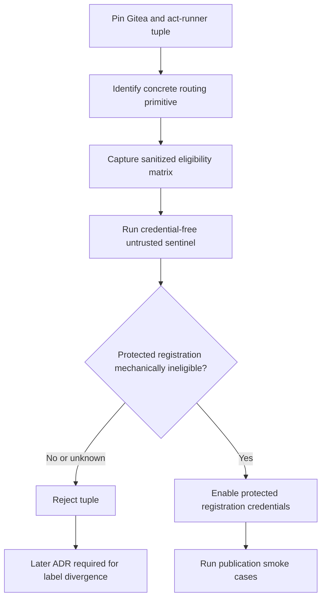

# ADR-0015: Prove Gitea runner trust-class routing before enabling credentials

- **Status:** Superseded by ADR-0035
- **Scope note (2026-10-06):** Epic E009 was rescoped to drop live-Gitea-runner certification
  (see epic.yaml goal). The trust-class/routing *design* below (two separately-scoped runner
  registrations, no publication credential reachable from an untrusted context) remains the
  recorded decision, and its config-shape is checked statically in
  `tests/ci/test_runner_trust_routing.py`. The scheduling-race behavioral proof, the
  credential-free sentinel job, and the `TokenPermissionMode=restricted` live denial test
  (originally filed as BL-E009-007/012) require an actual Gitea runner pool and are out of
  scope; resolved `wontfix` in `issues.yaml`.
- **Date:** 2026-10-06
- **Deciders:** Maintainer + architecture gate
- **Epic:** E009
- **Departs from spec:** n/a
- **Principle(s) in tension:** Core §3 design by contract, Core §4 testability, least-privilege workflow execution, and one shared workflow topology

## Context

Epic E009 needs two runner trust classes: untrusted verification must be able to execute pull
request work without publication credentials, while protected publication must run only inside a
credential-bearing boundary. The current design gives both registrations the shared
`ubuntu-24.04` label and expects Gitea registration scope to isolate them.

A shared label does not itself discriminate by trust class. Repository- or owner-scoped runner
registration is acceptable only if the pinned Gitea server and act-runner tuple has a concrete,
enforced scheduling primitive that makes the protected registration **ineligible** for an
untrusted job. Merely observing that the verification runner won a scheduling race is not proof:
the protected runner might still have been eligible and claim the next job.

The decision must fail closed before any publication credential exists on or is passed to the
protected runner. This follows the same two-guard pattern used by ADR-0006 for privileged release
finalizers: configuration constrains the permitted authority, and a behavioral negative test
proves the prohibited path is refused because neither guard is sufficient alone.

## Options considered

| Option | Pros | Cons | Standards fit |
|--------|------|------|---------------|
| A. Treat distinct registration scopes plus a shared label as sufficient | No topology change; simplest setup | Cannot prove the protected runner was ineligible rather than merely losing a race; risks exposing credentials to untrusted work | Violates design by contract, testability, and least privilege |
| B. Require a named Gitea routing primitive plus configuration and behavioral denial proof before credentials | Preserves the shared workflow and label when the pinned tuple truly supports isolation; rejects ambiguous routing before secrets exist | May reject otherwise functional tuples; requires staging probes and retained scheduler evidence | Best fit: explicit invariant, fail-closed boundary, mechanically testable |
| C. Introduce distinct trust-class labels immediately | Gives workflows an explicit routing selector | Changes the existing topology and portability contract before the pinned tuple proves it is necessary | Potentially sound, but requires a separate architecture decision and recertification |

## Decision

Choose **Option B**.

The pinned tuple is acceptable only when Story 9.1 identifies the exact Gitea scheduling primitive
and proves that it mechanically excludes the protected registration from untrusted jobs while
allowing the intended protected publication jobs. The proof has two mandatory parts:

1. **Configuration proof:** retain a sanitized scheduler/registration export that names the
   primitive, its scope and policy, both runner identities, and a trust-class eligibility matrix.
   The matrix must show the protected registration as ineligible for every untrusted repository,
   fork, pull-request, and equivalent verification context in scope.
2. **Behavioral denial proof:** before any publication credential is provisioned, submit a
   credential-free untrusted sentinel job and record the selected runner identity plus the
   scheduler's denial/ineligibility evidence for the protected registration. A planted overlapping
   scope or policy must make the routing gate fail even when the untrusted runner happens to claim
   the sentinel first.

The configuration and behavioral proofs are conjunctive. Successful execution on the untrusted
runner alone never establishes isolation. The routing gate is a prerequisite of credential
provisioning and all publication smoke cases.

If the pinned same-label tuple has no primitive capable of satisfying both proofs, the tuple is
rejected. Epic E009 does not silently introduce a label split or weaken the denial requirement.
Distinct trust-class labels or another topology change may be proposed only in a later ADR, after
which the affected workflow topology and Gitea certification must be rerun.

## Consequences

- Positive: publication credentials cannot be enabled on the strength of a scheduling race or an
  unverified registration-scope assumption.
- Positive: the retained eligibility matrix and runner-identity evidence make the isolation claim
  reviewable and repeatable for the exact pinned tuple.
- Positive: the shared label and workflow topology remain viable when Gitea provides a genuine
  policy-level discriminator.
- Negative / trade-off accepted: a Gitea tuple may be rejected even when ordinary jobs appear to
  route correctly, because appearance without mechanical exclusion is insufficient.
- Negative / trade-off accepted: staging must expose enough sanitized scheduler evidence to prove
  ineligibility without leaking registration tokens or publication credentials.
- Follow-up: if no supported same-label tuple passes, author a later ADR for label divergence or
  another routing topology; do not amend this decision through an implementation shortcut.

## Diagram

