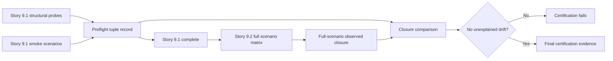

# ADR-0016: Split Gitea tuple preflight evidence from final certification evidence

- **Status:** Superseded by scope (2026-10-06)
- **Scope note (2026-10-06):** Epic E009 was rescoped to drop live-Gitea-runner certification
  entirely; there is no Story 9.2 live certification matrix for this decision to sequence
  evidence ahead of. Retained for historical record only. Originally-filed follow-up
  BL-E009-011 is resolved `wontfix`.
- **Date:** 2026-10-06
- **Deciders:** Maintainer + architecture gate
- **Epic:** E009
- **Departs from spec:** n/a
- **Principle(s) in tension:** Core §1 separation of concerns, Core §3 design by contract, and Core §4 testability

## Context

Epic E009 is deliberately sequenced: Story 9.1 pins and preflights the Gitea runner tuple, then
Story 9.2 exercises the complete certification matrix and gates migration. Story 9.1 currently
requires an observed transitive action closure for “every certified scenario.” Those scenarios do
not run until Story 9.2, which depends on Story 9.1. The predecessor therefore cannot complete
without evidence owned by its successor.

An observed action closure is execution evidence, not a static promise. Each story can own only
the closure of scenarios it actually runs. The boundary must still detect actions hidden inside
nested reusable workflows and local composites, and the final certification must cover the whole
positive, negative, recovery, and cleanup matrix before migration.

## Options considered

| Option | Pros | Cons | Standards fit |
|--------|------|------|---------------|
| A. Keep full-scenario closure in Story 9.1 | One nominal tuple record | Creates a completion cycle because Story 9.2 owns those executions | Violates separation of concerns and an executable completion contract |
| B. Move all action observation to Story 9.2 | Removes the cycle | Story 9.1 could approve a tuple without observing the actions used by its own load-bearing preflight | Weakens the preflight gate and testability |
| C. Story 9.1 owns preflight/smoke closure; Story 9.2 owns full-scenario closure and final evidence | Each story proves what it executes; preserves an early tuple rejection gate and complete final certification | Requires two explicitly related closure records and drift comparison | Best fit: acyclic ownership, explicit contracts, testable stages |

## Decision

Choose **Option C**.

Story 9.1 owns the **preflight tuple record**. Its observed transitive action closure is limited to
the structural probes and secondary smoke scenarios executed by Story 9.1. It includes actions
reached through both reusable workflows and all local composites traversed by those scenarios.
Observed-versus-recorded drift inside that bounded set fails Story 9.1. Story 9.1 neither predicts
nor claims closure for Story 9.2 scenarios that have not run.

Story 9.2 owns the **full-scenario closure** and **final certification evidence**. It observes the
transitive action set across every required positive, negative, publication, failure, rerun,
cleanup, and migration-gate scenario. It binds that closure to the pinned tuple and retained
certification evidence, compares it with Story 9.1's preflight record, and fails on unexplained
additions, omissions, or resolution drift. Only Story 9.2 may assert that the action closure is
complete for the certified scenario set.

The two records are related but not interchangeable: the preflight record is an input to Story
9.2, while the full-scenario record is a Story 9.2 output. This preserves the dependency direction
`E009-S01-001 -> E009-S01-002` and prevents either story from passing on future evidence.

## Consequences

- Positive: Story 9.1 has a satisfiable completion contract and can reject an incompatible tuple
  before publication credentials or full certification work.
- Positive: Story 9.2 remains accountable for complete observed closure across every scenario
  used to authorize migration.
- Positive: comparison between the records exposes actions that appear only in publication,
  failure, rerun, or cleanup paths.
- Negative / trade-off accepted: the evidence set contains a bounded preflight record and a final
  full-scenario record rather than one prematurely declared record.
- Negative / trade-off accepted: action drift discovered only in Story 9.2 blocks certification
  even when Story 9.1 previously passed.
- Follow-up: the final certification report must identify both record digests and explain any
  intentional difference; action trust-policy decisions remain governed separately.

## Diagram

