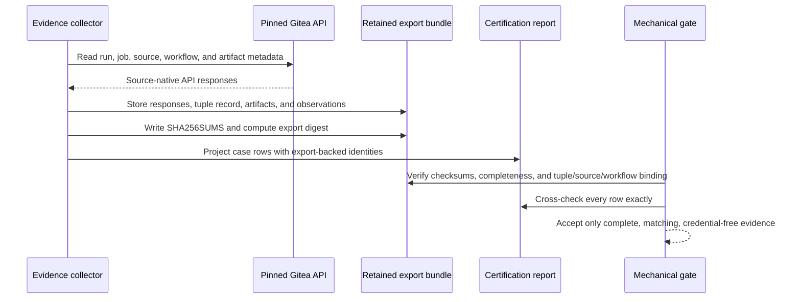

# ADR-0017: Authenticate Gitea certification evidence with retained API exports

- **Status:** Superseded by ADR-0035 (2026-10-08; the E009 scope change of 2026-10-06 below
  retired it first, and ADR-0035 replaced the pipeline it governed)
- **Scope note (2026-10-06):** Epic E009 was rescoped to drop live-Gitea-runner certification;
  there is no staging certification report gating migration, so the evidence-authenticity
  mechanism this ADR defines has no current consumer. The validator/schema built in
  `tests/ci/test_certification.py` (`resolve_certification_report`) is kept as a tested
  reference implementation in case a future epic revives live certification, but acquiring a
  real evidence export (originally BL-E009-020) is resolved `wontfix`.
- **Date:** 2026-10-06
- **Deciders:** Maintainer + architecture gate
- **Epic:** E009
- **Departs from spec:** n/a
- **Principle(s) in tension:** Decision-grade migration evidence, minimal repository-owned schemas, reproducible offline verification

## Context

Epic E009 gates repository-owner migration on a staging certification report. Checking that the
report contains every required case, a run URL, and a conclusion proves only document shape. A
stale or fabricated row can satisfy that check unless the report is bound to evidence acquired
from the pinned Gitea instance and to the exact runner tuple, source, workflow, jobs, and artifacts
that were certified.

Gitea's API is the authority for run and job identity, timestamps, attempts, and conclusions. The
published workflow artifacts and registry/release observations are the authorities for artifact
hashes and digests. The evidence must remain verifiable after the staging environment or API token
is gone, without storing a credential or translating Gitea responses into a second normalized run
schema.

## Options considered

| Option | Pros | Cons | Standards fit |
|--------|------|------|---------------|
| A. Validate Markdown shape only | Small and easy to review | Does not authenticate values; stale or fabricated evidence can authorize migration | Fails decision-grade evidence and design-by-contract |
| B. Re-query Gitea only when reviewing the gate | Uses the live authority directly | Not reproducible after retention expiry, cleanup, migration, or token rotation; review result can drift | Partly authentic but not durable |
| C. Retain raw API exports and referenced artifacts, checksum the export, and verify the report as a projection | Authenticated at collection, tamper-evident afterward, reproducible offline, preserves source-native API data | Adds retained evidence and collector/verifier logic; hashes prove post-collection integrity rather than server attestation | Best fit for testability, traceability, and minimal schema ownership |

## Decision

Choose option C.

Each certification attempt has one immutable evidence-export bundle collected directly from the
pinned Gitea API over the tuple's approved TLS trust path with a read-only evidence token. The
collector fails closed on an unexpected API authority, TLS failure, incomplete pagination, missing
field, or inconsistent identity. Credentials and authorization headers are never written to the
bundle.

The bundle retains source-native API response bodies and the referenced workflow evidence rather
than inventing a normalized run schema. Collectively it contains, for every required case:

- the Gitea repository and API authority;
- immutable workflow run ID, run attempt, job IDs, start/completion timestamps, and conclusions;
- source commit SHA and workflow identity, including workflow path and the workflow revision SHA;
- the canonical pinned-tuple record and its SHA-256 fingerprint;
- artifact names, sizes, and SHA-256 hashes, plus published image digests and other destination
  identities required by the case;
- the case identifier and the exact run/job records that satisfy it.

Raw API responses, the canonical tuple record, downloaded evidence artifacts, and destination
observations are listed in a deterministic `SHA256SUMS`. The SHA-256 of that checksum file is the
evidence-export digest. The export is frozen before the certification report is accepted; changing
any retained file produces a different digest.

The report is a human-facing projection, not an independent evidence authority. Every report row
records its case ID, run ID and attempt, relevant job IDs, source SHA, workflow identity, tuple
fingerprint, artifact hashes/digests, conclusion, and evidence-export digest. The mechanical gate
must resolve those values from the retained export and require exact equality. It also requires
one export-backed row for every independently registered required case and rejects extra,
duplicated, stale, cross-tuple, cross-source, cross-workflow, or unhashed evidence.

**Scope note (2026-10-06, resolves BL-E009-005 / AG-9):** the SHA-256 tuple fingerprint is also
this scheme's one non-secret correlation identifier. One certification attempt certifies exactly
one pinned tuple (ADR-0015), so the gate additionally requires every required case's row to carry
the *same* fingerprint — not merely a fingerprint that matches its own case's retained record — or
the export is rejected as mixing evidence from more than one attempt.

Live API collection authenticates evidence to the pinned Gitea authority at capture time; the
export digest makes the captured set tamper-evident and reproducible offline. A checksum does not
turn operator-authored data into Gitea evidence, so report-only fixtures and locally synthesized
API records cannot satisfy the migration gate.

## Consequences

- Positive: Migration approval is bound to the exact tuple, source, workflow execution, jobs, and
  artifacts that passed certification.
- Positive: Review remains reproducible after Gitea retention expires or credentials rotate.
- Positive: Source-native Gitea responses remain inspectable; the project does not own a parallel
  normalized run-record schema.
- Positive: Case-set completeness and evidence authenticity become independent checks: changing
  either the requirements registry or the evidence cannot silently bless the other.
- Negative / trade-off accepted: Certification stores more artifacts and needs explicit retention,
  redaction, and cleanup controls.
- Negative / trade-off accepted: The export digest proves integrity after acquisition, not an
  external Gitea signature. Trust at acquisition rests on the pinned API authority, approved TLS
  path, read-only collector, and recorded tuple.
- Follow-up: Story 9.2 implements the collector, export verifier, report cross-check, redaction
  scan, negative plants, and retention location in the certification runbook.

## Diagram

