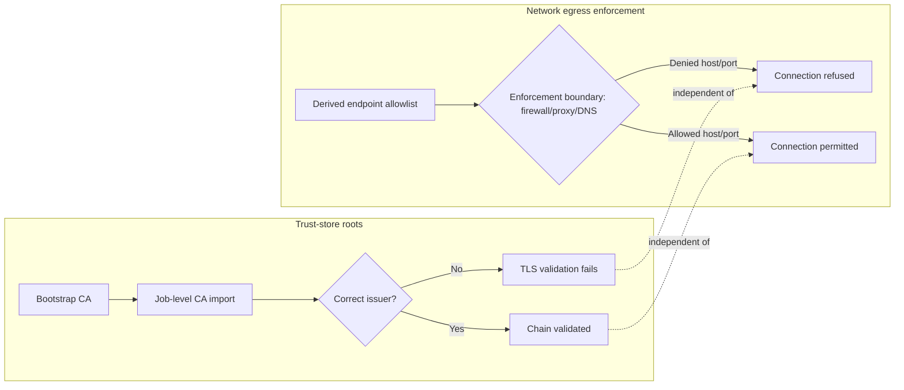

# ADR-0018: Separate TLS issuer trust from network-egress authorization

- **Status:** Accepted
- **Date:** 2026-10-06
- **Deciders:** Maintainer + architecture gate
- **Epic:** E009
- **Departs from spec:** n/a
- **Principle(s) in tension:** Core §1 separation of concerns, Core §3 design by contract

## Context

Story 9.1 derives an endpoint set from the workflows, local composite actions, action-resolution
configuration, and `docker/Dockerfile`, then proposes "omit one derived verifier endpoint" as a
trust negative case. A CA bundle grants issuer trust — it answers "do I accept this certificate's
chain?" — and is not an endpoint allowlist. Omitting an endpoint from a CA bundle does not deny
that endpoint; it only breaks TLS validation for whichever certificate chain that CA happened to
issue, which may not even be the endpoint's own certificate. Conversely the stories assert
"minimal network access" without naming the control that enforces it: no firewall, proxy, or DNS
boundary is given ownership of the derived endpoint allowlist, so there is nothing that actually
denies the omitted endpoint at the network layer.

Treating these as one mechanism lets a reviewer accept a CA-only negative case as proof of network
isolation, when it proves neither: a wrong-CA failure demonstrates TLS validation works, not that
an unlisted endpoint is unreachable, and an endpoint with a trusted root but no route-level
allowance would be refused for the wrong reason if it were ever reached.

## Options considered

| Option | Pros | Cons | Standards fit |
|--------|------|------|---------------|
| A. Keep a single "trust and access" control and accept CA omission as the negative case for both | No new enforcement layer to build or operate | Does not prove egress denial at all; silently passes network-isolation claims on TLS-only evidence | Violates separation of concerns and testability |
| B. Split into (a) trust-store roots/rotation and (b) network egress destinations/enforcement, each with its own owner, evidence, and negative test | Each claim is proven by the mechanism that actually makes it true; wrong-issuer and denied-destination failures are distinguishable in evidence | Requires naming and operating an egress enforcement boundary (firewall/proxy/DNS) in addition to CA management | Best fit: matches each principle's control to its claim |
| C. Drop the network-isolation claim and certify TLS trust only | Simplest; removes the untestable assertion | Understates the staging environment's actual exposure; "minimal network access" is a real requirement elsewhere in the epic goal and cannot simply be dropped | Fails the epic's least-privilege and isolation intent |

## Decision

Choose **Option B**.

Story 9.1 and Story 9.2 model two distinct controls:

1. **Trust-store roots and rotation** — bootstrap and job-level CA bundles grant issuer trust for
   the private CA. Negative test: a bundle missing or containing the wrong issuer must fail TLS
   validation rather than falling back to system trust. This proves nothing about reachability.
   `dev.yaml` and `release.yaml` import job-level downstream trust with
   `LiquidLogicLabs/git-action-ca-certificate-import@v3`, gated on the corresponding
   `GITEA_PACKAGE_INDEX_CA_CERTIFICATE` / `GITEA_FORGE_API_CA_CERTIFICATE` secret being set, so
   the step is absent by construction on GitHub (E009-S01-001). This is a granted privilege under
   ADR-0009: the action receives the certificate bundle through `with: certificate`, so it rides a
   floating major like the repository's other maintainer-owned `LiquidLogicLabs` actions
   (`CREDENTIAL_ACTIONS_ON_MOVING_REFS` in `tests/ci/support.py`).
2. **Network egress destinations and enforcement** — an explicit, owned enforcement boundary
   (firewall, proxy, or DNS-level denial, named per the pinned tuple's actual staging topology)
   holds the derived endpoint allowlist. Negative test: a denied host or port must be refused by
   that boundary, independent of whether its certificate would otherwise validate.

The report states explicitly whether public endpoints (PyPI mirrors are out of scope on Gitea per
E009-S01-001, but GHCR, the Alpine CDN, and Docker Hub/BuildKit/QEMU sources remain) rely on system
trust or the same private interception root, since that determines which control, if either, covers
them. An endpoint with no enforcement owner is a scope gap, not an accepted risk, and must be named
in the report rather than left implicit.

## Consequences

- Positive: a CA-omission negative case and a denied-destination negative case can no longer be
  satisfied by the same evidence, so passing one no longer implies the other is also proven.
- Positive: the report names which of GHCR/Alpine/Docker Hub/etc. ride system trust versus private
  interception, closing a gap the prior language left implicit.
- Negative / trade-off accepted: certification must stand up and exercise an egress-enforcement
  boundary in staging in addition to CA rotation testing, adding one more control surface to certify.
- Follow-up: if the pinned Gitea staging topology has no enforceable egress boundary available,
  that is a certification blocker for the network-isolation claim, not a silent pass on TLS
  evidence alone.

## Diagram

