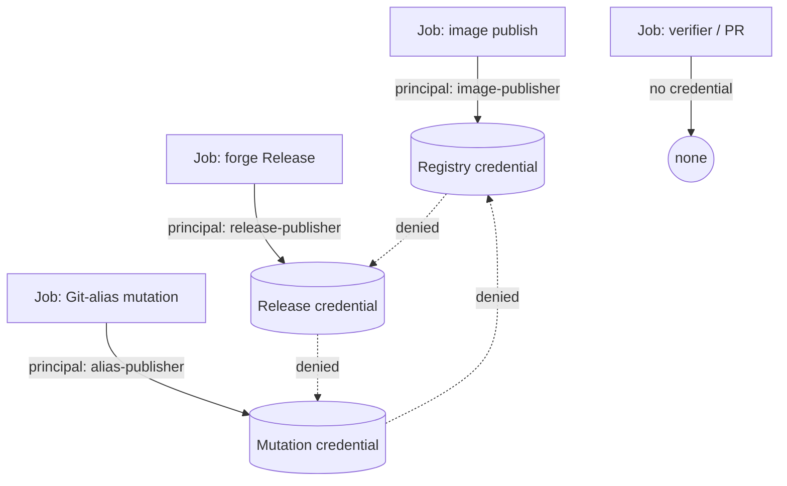

# ADR-0019: Per-job credential matrix with distinct principals and denial proofs

- **Status:** Superseded by ADR-0035
- **Date:** 2026-10-06
- **Deciders:** Maintainer + architecture gate
- **Epic:** E009
- **Departs from spec:** n/a
- **Principle(s) in tension:** Core §3 design by contract, GitHub Actions overlay — least privilege/secrets

## Context

The stories assert credential isolation ("only the forge package token", "job-local credentials")
without a complete credential interface. Neither story names: the login identity each job
authenticates as, the exact secret inputs available to it, the minimum token scopes each requires,
whether image publication, forge Release creation, and Git-alias mutation use the same or distinct
principals, or a negative test proving one destination's credential cannot mutate another
destination. "Only the forge package token" describes one destination; it does not establish
least privilege across the whole publication surface, and it gives an implementer no table to
build against — two independent implementations of "job-local credentials" could easily disagree.

## Options considered

| Option | Pros | Cons | Standards fit |
|--------|------|------|---------------|
| A. Leave credential scope to implementation discretion, documented after the fact | No upfront design cost | Already demonstrated to under-specify; invites scope creep of a single broad credential across destinations | Violates least privilege and design by contract |
| B. Require an explicit per-job credential matrix (principal, secret name, scopes, protected owner/environment, permitted/forbidden mutations) with cross-destination denial tests, before certification | Makes least privilege falsifiable; a reviewer or test can check the matrix against actual job definitions | Requires enumerating every publication destination's credential needs up front; more design and test surface | Best fit: matches the overlay's least-privilege and secrets requirements directly |
| C. Mandate one combined low-privilege principal for all destinations | Simplest credential surface | Combines blast radius across image, package, Release, and Git-alias mutation; a single compromised credential affects all destinations | Violates least privilege unless explicitly accepted via a separate trade-off |

## Decision

Choose **Option B**.

Story 9.1 and Story 9.2 must record a credential matrix with one row per job that holds any
publication-capable credential. Each row states:

- **Principal / login identity** — the account or token identity the job authenticates as.
- **Secret / context name** — the exact secret or OIDC/context value the job consumes.
- **Minimum scopes** — the narrowest set the job's required mutations need.
- **Protected owner / environment** — the Gitea environment or branch-protection gate the
  credential is scoped to, if any.
- **Permitted mutations** — the destinations and operations the credential is allowed to perform.
- **Forbidden mutations** — the destinations and operations it must not be able to perform.

Image publication, forge Release creation, and Git-alias mutation use **distinct principals**
unless the matrix records an explicit ADR-level trade-off accepting a combined blast radius for a
named pair, with the reason stated. Verifier/PR jobs and any job with no publication need receive
no publication-capable secret at all, matching the existing secret-free verifier invariant
(ADR-0007).

Negative tests prove the matrix, not just describe it: for each destination, attempt the mutation
with another destination's credential and require denial. A disabled destination's job must
receive no secret for that destination, not a scoped-down one.

## Consequences

- Positive: least privilege is checkable against a concrete table instead of a prose assertion;
  "only the forge package token" becomes one verifiable row among several.
- Positive: a credential compromise's blast radius is explicit and bounded by principal, not
  assumed to be contained by convention.
- Negative / trade-off accepted: certification must provision and test more distinct credentials
  than a single shared principal would require, adding staging setup cost.
- Follow-up: if the pinned Gitea tuple cannot issue distinct principals for a given pair of
  destinations, that pairing requires its own ADR-level trade-off recorded in the matrix, not a
  silent merge.

## Permission-scope boundary (2026-10-06, resolves BL-E009-002)

The workflows' `permissions:` blocks declare exactly four scopes explicitly — `contents`,
`packages`, `id-token`, `attestations` — not GitHub's full ~15-scope vocabulary (`actions`,
`checks`, `deployments`, `discussions`, `issues`, `pages`, `pull-requests`,
`repository-projects`, `security-events`, `statuses`, and others). This is a deliberate boundary,
not an oversight:

- The four scopes are exactly the ones the credential matrix above depends on: every job that
  mutates one of these four authenticates against a named principal and a negative test proves it
  cannot reach another destination. No job in this repository's workflows reads or writes any of
  the other ~11 scopes, so there is nothing for those rows to isolate.
- On **GitHub**, declaring any non-empty `permissions:` block makes every unlisted scope `none` by
  default (GitHub's documented deny-by-default behavior). The four explicit scopes are therefore
  already a complete enumeration of this repository's authority on GitHub; no residual grant
  exists there.
- On **Gitea**, the instance-level `TokenPermissionMode` default is `permissive`, and Gitea's docs
  do not commit to GitHub's unlisted-scope-is-none reading. Whether an unlisted scope silently
  grants broader-than-intended authority on a given Gitea instance is therefore a property of that
  instance's configuration, not of this repository's workflow YAML — it can only be settled by
  inspecting or probing a real, pinned Gitea deployment.
- Epic E009 was rescoped (2026-10-06) to drop live-Gitea-runner certification. Proving or
  disproving the Gitea residual-grant risk is exactly that kind of live-deployment-dependent
  proof, so it is out of scope here. **Decision:** keep the four-scope declaration (it is complete
  and correct for every destination this repository's workflows actually touch); if this project
  is ever operated against a live Gitea instance, re-open the residual-grant question against that
  instance's actual `TokenPermissionMode` and scope-mapping behavior before trusting the existing
  four-scope blocks unmodified on Gitea specifically.

## Diagram

