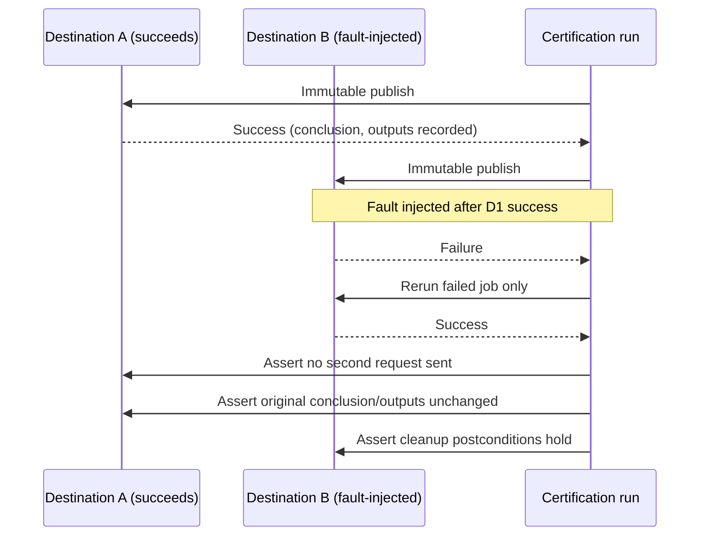

# ADR-0020: Deterministic fault injection and cleanup postconditions for failed-jobs-only recovery

- **Status:** Superseded by ADR-0035
- **Scope note (2026-10-06):** Epic E009 was rescoped to drop live-Gitea-runner certification.
  The fault-injection/cleanup-postcondition *contract* (schema, pre/post-state capture shape,
  rerun-identity rule) remains the recorded decision and is validated statically against
  synthetic fixtures in `tests/ci/test_certification.py` (`assert_recovery_contract`). The real
  rerun rehearsal against a live Gitea instance (originally BL-E009-017/018) is resolved
  `wontfix`.
- **Date:** 2026-10-06
- **Deciders:** Maintainer + architecture gate
- **Epic:** E009
- **Departs from spec:** n/a
- **Principle(s) in tension:** Core §4 testability, Core §3 design by contract

## Context

Story 9.2 requires that "one destination fails after successful immutable publication elsewhere"
can be recovered by rerunning failed jobs only, without repeating successful immutable uploads. As
written, that scenario names an observation but not a reproducible cause: revoking a live
credential, breaking a network path, and corrupting an endpoint are three different failure
mechanisms with three different timings and three different kinds of residual remote state. Two
independent test implementations of "a destination fails" could exercise entirely different
failure modes and both claim to satisfy the acceptance criterion, while leaving different garbage
behind. Cleanup is asserted but its required postconditions — what must be true of packages,
images, releases, aliases, tokens, artifacts, and runner workspaces after recovery — are not
defined, so "cleanup happened" cannot be checked against anything concrete.

## Options considered

| Option | Pros | Cons | Standards fit |
|--------|------|------|---------------|
| A. Leave the failure mechanism and cleanup scope to the implementer's judgment at test-authoring time | Fastest to write | Not reproducible; different runs of "destination fails" exercise different code paths and may leave different residual state undetected | Violates testability |
| B. Specify one staging-only, destination-local fault-injection mechanism and the exact injection point after a known immutable mutation, plus explicit pre-state/expected-partial-state/rerun/cleanup postconditions | Reproducible across runs; cleanup becomes a checkable assertion rather than an unverified claim | Requires picking and documenting one specific injection mechanism per destination, and building cleanup assertions for every mutable resource class | Best fit: makes the failure and its recovery falsifiable |
| C. Treat the immutable-index rejection (duplicate-upload refusal) as sufficient proof that failed-jobs-only rerun worked | No additional injection mechanism needed | Proves only that a second upload was *refused*, not that the rerun *correctly skipped* attempting it, nor that other state was preserved — the two are different claims | Fails design by contract; the story itself calls this out as insufficient |

## Decision

Choose **Option B**.

For each publication destination (package upload, image publication, forge Release, Git-alias
mutation), certification names one staging-only fault-injection mechanism local to that
destination — for example: revoke that destination's credential immediately after its job's final
immutable mutation completes, or point that destination's client at an unreachable endpoint for
that job only. The injection point is always **after** at least one other destination has
completed its immutable publication, so the scenario under test is genuinely partial failure, not
total failure.

The scenario records, before rerun:

- **Pre-state** — which destinations succeeded, their recorded conclusions, start times, and
  outputs (including plan identity and `build-manifest-sha256`).
- **Expected partial state** — exactly which destination is expected to fail and why, given the
  injected fault.

After rerun, the scenario asserts:

- **Rerun identity** — the rerun targets only the failed job(s); it does not require re-running
  jobs that already succeeded.
- **Preservation** — the previously successful destinations' original conclusion, start time, and
  outputs are unchanged, and no second upload/publish request was made against them (not merely
  that a second request would have been refused).
- **Cleanup postconditions** — for packages, images, releases, aliases, tokens, artifacts, and
  runner workspaces touched by the failed and retried job: no orphaned partial upload remains after
  final success, no stale credential or workspace survives the run, and the destination's state
  after a successful rerun is indistinguishable from a single successful run that never failed.

An immutable-index rejection observed during the scenario is recorded as a defense-in-depth
signal, not accepted in place of the preservation and cleanup assertions above.

## Consequences

- Positive: "destination fails" is now one specific, repeatable action per destination, so the
  recovery scenario tests the same thing on every run.
- Positive: cleanup has concrete postconditions a test can assert against, rather than depending on
  an unverifiable claim that cleanup "happened."
- Negative / trade-off accepted: certification must build and maintain one fault-injection
  mechanism per destination, increasing staging scenario count and maintenance surface.
- Follow-up: if a destination has no safe staging-only fault-injection mechanism available, that
  destination's failed-jobs-only recovery claim cannot be certified and must be recorded as an
  open gap rather than asserted from the immutable-index rejection alone.

## Diagram

