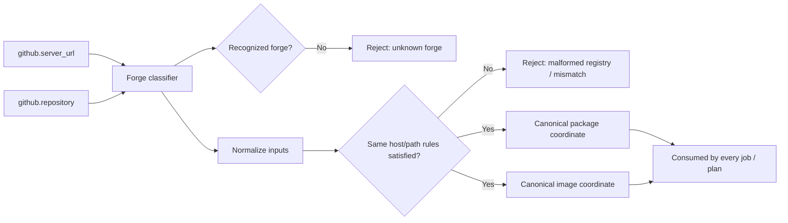

# ADR-0021: One authoritative forge classifier and coordinate projection contract

- **Status:** Superseded by ADR-0035
- **Date:** 2026-10-06
- **Deciders:** Maintainer + architecture gate
- **Epic:** E009
- **Departs from spec:** n/a
- **Principle(s) in tension:** Core §3 design by contract, Core §4 testability

## Context

Story 9.1 requires that every registry and image coordinate derive from `github.server_url` and
`github.repository` alone, rejects unknown forges, and demands a malformed-registry negative test.
It does not define: the set of accepted forge identities, how a forge is recognized from those two
context values, normalization rules (case, trailing slash, scheme), same-host/same-path
requirements, the canonical Gitea package and image coordinate shapes the classifier must produce,
or the failure taxonomy distinguishing "unknown forge" from "malformed registry" from other
rejection reasons. Two independent implementations of "derive coordinates from context" can
legitimately disagree on all of the above while both claiming to pass the story's prose, because
the story names the inputs and the existence of negative cases without naming the function that
connects them.

## Options considered

| Option | Pros | Cons | Standards fit |
|--------|------|------|---------------|
| A. Let each workflow/job compute its own coordinates from the two context values independently | No shared component to build | Independent implementations can disagree on normalization and canonicalization even when both pass their own tests; a classifier bug would need fixing in multiple places | Violates design by contract (no single authoritative interface) and reuse |
| B. Define one authoritative forge classifier and coordinate-projection contract — accepted inputs, normalization, canonical outputs, and failure taxonomy — consumed as the single value by every job that needs it | Removes the possibility of two jobs disagreeing on the same inputs; the contract is independently testable with table-driven cases | Requires designing and placing one shared classifier component, and migrating any ad hoc coordinate logic to consume it | Best fit: single authoritative interface, testable contract |
| C. Defer coordinate contract definition to implementation time, document after the fact | No upfront design cost | Already the status quo that produced this finding; does not resolve the ambiguity, only postpones it | Fails design by contract and testability |

## Decision

Choose **Option B**.

Story 9.1 adds one authoritative forge classifier and coordinate-projection function, consumed by
every job and the plan as the single value for forge identity and package/image coordinates. Its
contract states:

- **Accepted inputs** — `github.server_url` and `github.repository`, and no other operator-
  supplied value (`FORGE_REGISTRY` remains retired per the existing configuration contract).
- **Forge recognition** — the exact rule for recognizing a supported forge (e.g. Gitea) from
  `server_url`, and the explicit rejection of anything else as "unknown forge."
- **Normalization** — case folding, trailing-slash handling, and scheme requirements applied
  before comparison or projection.
- **Same-host/same-path rules** — whether package/image coordinates must share host and path
  segments with the source repository, and what constitutes a mismatch.
- **Canonical outputs** — the exact Gitea package coordinate and image coordinate shapes the
  classifier produces for a given accepted input pair.
- **Failure taxonomy** — distinct, named rejection reasons for unknown forge, malformed registry,
  normalization failure, and same-host/path mismatch, so a test can assert *which* rejection fired,
  not merely that rejection occurred.

Table-driven positive and negative cases cover each accepted forge, each rejection reason, and at
least one normalization edge case (trailing slash, case difference). The plan and every consuming
job reference this classifier's output rather than recomputing coordinates independently.

## Consequences

- Positive: two jobs can no longer silently disagree on a derived coordinate, because there is
  exactly one function producing it.
- Positive: "unknown forge" and "malformed registry" become independently assertable outcomes
  instead of one undifferentiated rejection case.
- Negative / trade-off accepted: introduces one shared component that every coordinate-consuming
  job must call, rather than inline derivation — a small coupling cost in exchange for a single
  source of truth.
- Follow-up: if a future epic adds a second supported forge, its recognition and canonical output
  rules extend this same classifier contract rather than introducing a parallel one.

## Diagram

