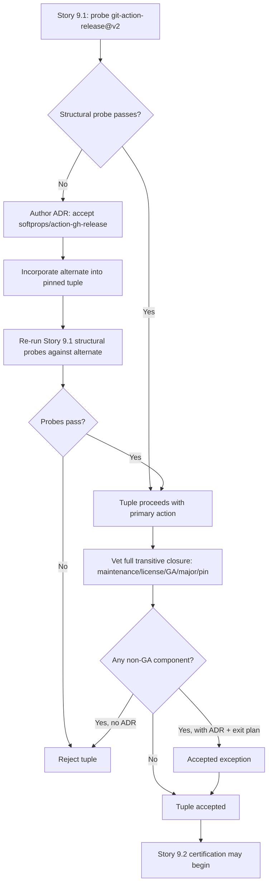

# ADR-0022: Action governance for the pinned tuple, and release-fallback ownership

- **Status:** Accepted, scope-limited 2026-10-06
- **Scope note (2026-10-06):** Epic E009 was rescoped to drop live-Gitea-runner certification.
  Action-governance checks (maintenance/license/GA status, SHA-pin enforcement) are
  this repo's own closure-vetting responsibility, checked statically against GitHub-published
  action metadata in `tests/ci/test_action_governance.py`, and remain in scope. The
  `git-action-release@v2` Gitea-path network/trust-boundary probe (and any resulting
  release-fallback ADR) requires an actual private-CA Gitea runner and is out of scope;
  originally-filed BL-E009-009/021 are resolved `wontfix`. Until probed live, treat the
  Gitea-path network behavior as unverified rather than trusted.
- **Date:** 2026-10-06
- **Deciders:** Maintainer + architecture gate
- **Epic:** E009
- **Departs from spec:** n/a
- **Principle(s) in tension:** Core §7 dependency selection, Core §8 GA over preview, GitHub Actions overlay — pinning

## Context

Story 9.1 records an observed transitive action closure and its resolution source, but recording
an action set is not the same as vetting it: nothing in the stories requires that every action in
the closure is actively maintained, compatibly licensed, generally available (not preview/beta),
on a currently supported major version, or pinned to a standard commensurate with whether it
carries credentials. The fallback language mentions SHA pinning only for the
`softprops/action-gh-release` alternate path — the primary credential-bearing action paths
(`git-action-release@v2`, `actions/checkout@v7`, `actions/setup-python@v7`, and anything reached
inside the reusable workflows and local composites) have no equivalent acceptance rule. A pinned
tuple can therefore certify a closure containing stale, unmaintained, or moving-reference
dependencies and still pass.

Separately, the release-action fallback crosses the Story 9.1/9.2 boundary ambiguously: Story 9.1
owns probing `git-action-release@v2` and says structural incompatibility rejects the tuple before
Story 9.2, but Story 9.2 may take the `softprops/action-gh-release` branch "after a separate ADR."
The stories do not say whether Story 9.1 can close with a failed primary probe, who authors/approves
that ADR, or whether the alternate action must be folded back into Story 9.1's tuple preflight and
re-probed before Story 9.2 begins.

## Options considered

| Option | Pros | Cons | Standards fit |
|--------|------|------|---------------|
| A. Accept any action resolvable at pin time, record only reference and resolved commit | Minimal governance overhead | Permits stale, unmaintained, non-GA, or under-pinned dependencies to certify unchallenged | Violates dependency selection and GA-over-preview |
| B. Extend tuple acceptance to require publisher/trust class, maintenance/license/GA status, and supported-major for every action in the closure; require full-SHA pinning for credential-bearing or unapproved third-party actions; require an ADR plus exit plan for any non-GA/preview component. Make release-fallback selection a predecessor decision owned by Story 9.1, re-probing the alternate before Story 9.2 begins | Closes the governance gap for the whole closure, not just the documented fallback; removes the story-boundary ambiguity by giving one story clear ownership and a clear gate | Requires vetting every action in a potentially large transitive closure, and re-running Story 9.1 probes if the primary release action fails | Best fit: matches both the governance and ownership gaps directly |
| C. Resolve fallback ownership only, leave action governance as recording-only | Smaller change | Leaves the broader governance gap (finding 8) unresolved; a pinned tuple could still certify an unmaintained or non-GA action elsewhere in the closure | Partially addresses the finding, not fully |

## Decision

Choose **Option B**.

**Action governance.** Story 9.1's tuple record extends beyond reference and resolved commit to
include, per action in the observed transitive closure: publisher and trust class (first-party,
approved third-party, or unapproved third-party), maintenance status, license compatibility, GA
status, and currently supported major version. Credential-bearing actions and any unapproved
third-party action require a full-SHA pin, not a floating major-version tag. Any action found to
be non-GA/preview requires its own ADR recording the accepted risk and an explicit exit plan
(Core §8); absent that ADR, a non-GA component in the closure rejects the tuple.

**Release-fallback ownership.** Probing `git-action-release@v2` is a **Story 9.1 predecessor
decision**, not a Story 9.2 branch point. Story 9.1 either:

1. passes the primary probe, and the pinned tuple proceeds with `git-action-release@v2`; or
2. fails the primary probe, authors the ADR accepting the `softprops/action-gh-release` alternate
   (owner-policy and SHA-pin changes included), incorporates the alternate into the pinned tuple,
   and **re-runs Story 9.1's structural probes against the alternate** before Story 9.1 is
   considered done.

Story 9.1 does not close with a failed primary probe and an unresolved alternate; Story 9.2 never
makes this selection itself, and no certification scenario exercises a release action that has not
passed Story 9.1's preflight.

## Consequences

- Positive: the pinned tuple cannot certify an unmaintained, incompatible-license, non-GA, or
  under-pinned action anywhere in its transitive closure without an explicit, reviewed exception.
- Positive: release-action fallback has one clear owner and one clear gate; Story 9.2 never
  inherits an undecided dependency choice from its predecessor.
- Negative / trade-off accepted: vetting the full transitive closure (not just the directly
  referenced actions) adds tuple-acceptance work, and a failed primary release-action probe can
  require re-running Story 9.1's structural probes against the alternate before proceeding.
- Follow-up: any non-GA/preview action accepted under this ADR carries its own exit plan and must
  be re-evaluated at its next natural review point (next epic touching the pinned tuple, or GA
  release of that dependency, whichever comes first).

## Diagram

