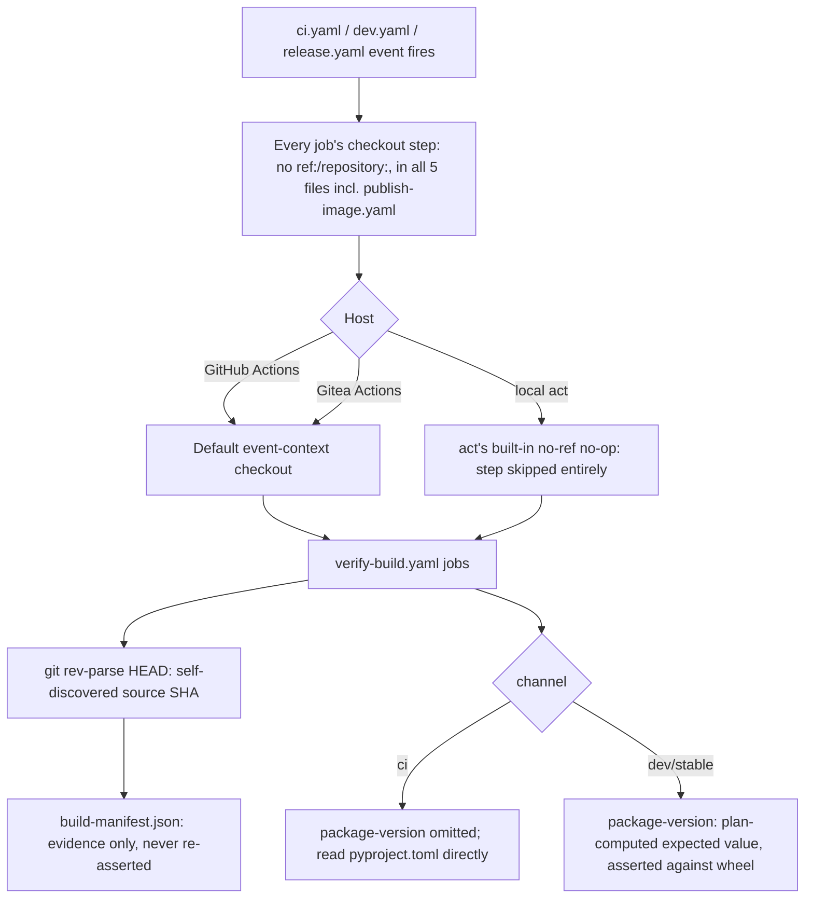

# ADR-0028: Ref-free checkout across all CI/CD workflows

- **Status:** Accepted
- **Amended by:** ADR-0046 (re-anchored to CI spine AD-6; see the amendment at the end)
- **Date:** 2026-10-08
- **Deciders:** Maintainer + architecture gate
- **Epic:** (origin) Epic E012, Story 3 — fix local `act-build.sh` checkout/mount strategy
- **Departs from spec:** Amends CI-AR2 (generalizes, does not weaken); adds CI-AR42–CI-AR46;
  clarifies CI-AR33 to `_bmad-output/planning-artifacts/architecture/architecture-ci-cd-pipeline-2026-08-31/ARCHITECTURE-SPINE.md`.
- **Principle(s) in tension:** CI-AR2 (one workflow graph, no ACT-specific branching) vs.
  CI-AR33 (safe local `act` via disposable clone) vs. the need for every job in a reusable
  `workflow_call` chain to re-verify an externally-pinned source identity.

## Context

`verify-build.yaml`'s `source-integrity` job asserts `git rev-parse HEAD == $SOURCE_SHA`. To make
that assertion meaningful, every caller (`ci.yaml`, `dev.yaml`, `release.yaml`) computed a source
SHA up front and threaded it into every job's checkout step as `ref: <source-sha>` — 23
`actions/checkout` call sites across the pipeline's 5 workflow files, all pinned this way.

Running `docker/act-build.sh` locally against an unpushed commit reproducibly destroyed the
disposable clone's checkout: `actions/checkout` reconstructs its expected remote URL from the
`repository`/`server-url` inputs/context and compares it against the git directory's actually
recorded origin remote. Any mismatch — including a locally-rewritten `insteadOf` URL — triggers the
action's "ensure pristine checkout" logic, which deletes and reinitializes the directory. This is
the exact mechanism behind the 2026-09-01 destructive-checkout incident, and it was reproduced
safely, multiple times, in disposable `/tmp` sandboxes while investigating this ADR. It cannot be
avoided by picking a different `actions/checkout` version (v4 and v7 behave identically), and it
is not specific to `act` — it is `actions/checkout`'s own behavior whenever `ref:` is present and a
real fetch is attempted for a commit the remote does not have.

The only genuine no-op path turned out to belong to `act` itself, not to `actions/checkout`: `act`
skips the whole checkout step as a built-in special case, but only when the step's `with:` block
has no `ref:` key. This was re-confirmed, side-by-side in the same job set, in a disposable
sandbox on 2026-10-08: a checkout step with `ref:` set to the current commit's own SHA ran the
real `actions/checkout` JS inside the container, deleted the workspace, and failed fetching that
SHA from the real GitHub remote (`fatal: remote error: upload-pack: not our ref`); the sibling
step in the same run with no `ref:` key completed via a plain `docker cp` in under 40ms, for both
`actions/checkout@v4` and `@v7` — `nektos/act` issue #122 documents the same behavior as a
known, requested-for-refinement special case, not a bug. Comparing against three of the
maintainer's other local, `act`-based repositories confirmed the pattern: none of their checkout
steps ever pass `ref:`, which is why none of them had ever hit this failure. This repository's
`verify-build.yaml` is the outlier specifically because it threads a pre-computed source identity
through every job for integrity verification.

Several narrower fixes were considered and rejected before reaching this design:

- **Git URL `insteadOf` rewrites** to make the disposable clone's origin match what `checkout`
  expects — rejected: it reproduces the exact destructive-checkout mechanism this ADR exists to
  avoid, just relocated into `act-build.sh` instead of into CI.
- **`env.ACT`-based step branching** (different `ref:` handling when running under `act`) —
  rejected: Gitea's own hosted runners are themselves `act`-based, so `ACT` does not reliably
  distinguish "local developer machine" from "production Gitea CI," and this would also directly
  violate CI-AR2's "no step branches on `ACT`" rule.
- **A custom `LOCAL_VERIFY` environment flag** gating a different checkout step for local runs —
  rejected: still host-conditional branching, in tension with CI-AR2's underlying intent even
  though it would not literally be `env.ACT`.
- **Single checkout + artifact fan-out** (`source-integrity` checks out once, uploads the tree as
  an artifact, every other job downloads it instead of re-checking out) — this does solve the
  duplication and the destructive-checkout risk without any branching, and was seriously
  considered. It was set aside in favor of an even simpler design once it became clear `ref:` was
  only ever functionally load-bearing in one place in the entire pipeline (see below); see
  **Consequences** for the narrow trade-off accepted instead.

Re-examining *why* `ref:` existed at every site found it was redundant almost everywhere:

- `dev.yaml`/`release.yaml` fire on `push`/tag events; default checkout already resolves to
  `github.sha`, the same commit `ref: github.sha` was pinning to. No override was needed.
- `verify-build.yaml`'s 10 jobs all pinned `ref: inputs.source-sha`, needed only because the
  *caller* had already computed and wanted to re-assert that identity — not because any job
  needed a different commit than its own triggering event already pointed at.
- `ci.yaml`'s `plan` job was the **one** genuinely necessary override: GitHub's default
  `pull_request` checkout target is a synthetic `refs/pull/N/merge` commit (merge of PR head into
  base), not the PR's actual head SHA, so `ci.yaml` pinned `ref: github.event.pull_request.head.sha`
  to test the real head commit instead of the synthetic merge.

## Decision

Remove `ref:`, `repository:`, and every other identity-overriding `actions/checkout` input from
**every** checkout step in **all five** workflow files (`ci.yaml`, `dev.yaml`, `release.yaml`,
`verify-build.yaml`, and `publish-image.yaml`, which has its own `ref: inputs.source-sha`
checkout — missed in an earlier pass of this design and caught by the reviewer gate), including
`ci.yaml`'s PR path. Every checkout becomes the plainest possible `actions/checkout@v7` call
(`fetch-depth`/`fetch-tags`/`persist-credentials` only), relying purely on the ambient event
context GitHub, Gitea, and local `act` already provide — no conditionals of any kind, not
host-based, not channel-based. **No step after a ref-free checkout may re-pin identity by another
route** (a manual `git fetch`/`git checkout <sha>` shell step, an env-var-indirected `ref:`
expression, or a nested composite action that re-checks-out) — the rule is about the net effect,
not just the literal `with: ref:` key.

Consequences for each workflow:

- **`verify-build.yaml`:** drops `source-sha` as an input entirely. Each job that needs it
  discovers it via `git rev-parse HEAD` as the very next step after checkout — before any other
  step, so later steps cannot change what gets recorded — and emits it only as a job output for
  evidence/`build-manifest.json` purposes; it is never asserted against an externally supplied
  value, because there no longer is one. `package-version` becomes an optional `workflow_call`
  input (`required: false`): a caller that has one omits the key from `with:` entirely (never an
  empty string) when it doesn't apply. `dev.yaml`/`release.yaml` supply it only for their own
  dev/stable calls, to assert against the built wheel; the `ci` channel's call omits the key, and
  the `distribution` job then reads the committed `pyproject.toml` version directly and skips
  cross-validation.
- **`ci.yaml`:** collapses from two jobs (`plan` + `verify`) to one — it calls `verify-build.yaml`
  with only `channel: ci`. PR verification now exercises GitHub's synthetic merge-with-base commit
  instead of the pinned head SHA.
- **`dev.yaml`/`release.yaml`:** keep their `plan` jobs (genuine, channel-specific work: dev-distance
  version computation, stable exact-tag validation, including self-discovering their own
  `source-sha` via `git rev-parse HEAD` for downstream data-flow use), but stop re-threading
  `ref:` into their own downstream jobs' checkouts (`stable-tag-guard`, `attest`, the
  `verify-build.yaml` call, the `publish-image.yaml` call) — `github.sha` is immutably fixed for
  the whole run on a push/tag trigger, so default checkout already resolves identically
  everywhere. The `source-sha`/`package-version` **values** (never a checkout override) continue
  to flow downstream exactly as before, into `publish-image.yaml`'s required `source-sha` input
  and every destination job's `expected-source-sha`/`expected-package-version` arguments to the
  `verified-bundle` composite action — CI-AR36's boundary-revalidation chain is unchanged; only
  the checkout pinning is removed.
- **`publish-image.yaml`:** drops `ref: inputs.source-sha` from its own checkout step. Its
  `source-sha`/`package-version` inputs remain required, unchanged — they are consumed solely as
  assertion arguments to the `verified-bundle` composite action (CI-AR36), never as a checkout
  override, and `publish-image.yaml` is only ever called for the `dev`/`stable` channels (never
  `ci`), so its own ref-free checkout resolves to the same immutable `github.sha` as every other
  job in that run.
- **`docker/act-build.sh`:** unchanged in mechanism. Its disposable-clone wrapper is retained as
  cheap defense-in-depth (insurance against a future regression reintroducing a `ref:` somewhere),
  but is no longer load-bearing for the original failure mode: with zero `ref:` anywhere, every job
  hits `act`'s built-in no-op checkout path automatically, for every channel, with no custom flag
  needed.

Architecture spine updates: CI-AR2 amended (generalized, not weakened); CI-AR33 clarified
(no longer load-bearing, still retained); new CI-AR42–CI-AR46 added. See
`_bmad-output/planning-artifacts/architecture/architecture-ci-cd-pipeline-2026-08-31/ARCHITECTURE-SPINE.md`.

## Consequences

- Positive: eliminates the destructive-checkout failure mode for local `act` verification
  entirely, for every channel, without any environment-conditional branching — a strictly stronger
  form of CI-AR2's "no step branches on `ACT`" invariant (now: no step branches on anything, for
  checkout purposes).
- Positive: removes every duplicated `ref:` plumbing site and the `source-sha`
  input/output/re-assertion chain threaded through every `verify-build.yaml` job; fewer
  coordinates to keep consistent across all 5 workflow files. The `source-sha`/`package-version`
  assertion chain feeding `publish-image.yaml` and destination-job boundary revalidation (CI-AR36)
  is preserved unchanged — only the checkout-pinning use of those values is removed.
- Negative / trade-off accepted: PR-triggered (`ci.yaml`) runs now test GitHub's synthesized
  merge-with-base commit rather than the raw PR head SHA. This is GitHub's own standard default
  `pull_request` behavior (what most repositories' CI already tests) — but it is a real behavior
  change from this repository's prior exact-head-SHA verification.
- Negative / trade-off accepted, narrower: because no job's checkout is pinned and GitHub
  recomputes the synthetic merge ref on demand, two jobs in the same PR-triggered run that check
  out at different wall-clock times could in principle see different merge results if the base
  branch (`main`) moves in between. A single-checkout-plus-artifact-fanout design would close this
  gap but was deliberately not built — the residual risk is narrow (requires a base-branch push to
  race a single PR run) and well understood, and the maintainer explicitly chose the simpler,
  fully uniform design over the engineered mitigation.
- Follow-up: a workflow-contract test should assert (a) no `actions/checkout` step anywhere under
  `.github/workflows/` declares a `ref:` or `repository:` key, and (b) no later step in a job that
  contains a checkout step invokes `git fetch`/`git checkout`/`git reset --hard` against anything
  other than a path already present in the working tree — so a future change cannot silently
  reintroduce the original failure mode through an indirect route (CI-AR42).

## Amendment 2026-10-11 — re-anchored to CI spine AD-6 (ADR-0046)

The CI-AR rules this ADR amends and adds (CI-AR2, CI-AR42–CI-AR46) belong to the retired
2026-08-31 spine, and the workflows and `docker/act-build.sh` it names were removed by
ADR-0035. The decision itself is unchanged and binds through the CI/CD spine
(`_bmad-output/planning-artifacts/architecture/architecture-ci-cd-pipeline-2026-10-08/ARCHITECTURE-SPINE.md`)
AD-6: no checkout supplies `ref:` or `repository:`, no later step re-pins identity by another
route, and the `workflows-ref-free-checkout` pygrep hook in `.pre-commit-config.yaml`
enforces the key. Read the CI-AR references above as history.

## Diagram

