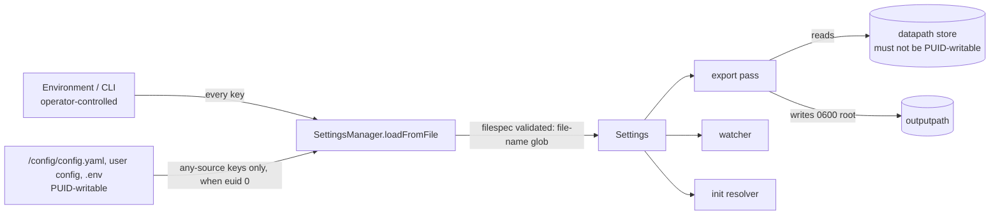

# ADR-0049: Root-mode settings trust covers the hook, the output path and the store location

- **Status:** Accepted
- **Date:** 2026-10-12
- **Deciders:** Maintainer + E015 epic architecture gate (l3io-arch-review + bmad-agent-architect)
- **Epic:** E015
- **Departs from spec:** `_bmad-output/planning-artifacts/architecture/architecture-traefik-certificate-exporter-2026-08-30/ARCHITECTURE-SPINE.md#ad-2--container-base-image-privilege-model-and-root-mode-settings-trust-adopted`
  (the AD-2 trust-class table and class rule as consolidated on 2026-10-12, which classed
  `datapath` and `filespec` `any-source` as "read only"; the spine is updated in the same
  change)
- **Principle(s) in tension:** Core §3 design by contract (unchecked input at the system
  edge); the maintainer constraint "do NOT break lsio and the way they do things" against
  the root boundary; global rule 4 (a guard proves its rule, not its reach); PRD FR-10
  (one precedence order for every setting) against PRD FR-18 (a file is not an admissible
  source for some keys in root mode); usability of PyPI installs run as root
- **Amends:** ADR-0030. E015-S01-001 replaces ADR-0030's paragraph that `/config` stays
  root-owned with a dated amendment pointing here.
- **Implemented by:** E015-S01-001 (merged 2026-10-12). This ADR is the root-mode trust ADR that the
  story's planning text called "ADR to be written by E015-S01-001"; the story implements it
  and does not write another one.
- **Records:** maintainer decisions MD-19 … MD-22 (2026-10-12) and MD-21 as extended on
  2026-10-12 by the AG-1 resolution
  (`_bmad-output/implementation-artifacts/epic-015/maintainer-decisions.md`); arch-gate
  findings AG-1, AG-6 and AR-1
  (`_bmad-output/implementation-artifacts/epic-015/arch/arch-gate-review.md`,
  `arch-gate-review-architect.md`). The spawn-site guard is ADR-0050.

## Context

**LinuxServer's convention.** The image is built on `ghcr.io/linuxserver/baseimage-alpine`.
Its `init-adduser` runs `lsiown abc:abc` over `/app`, `/config` and `/defaults` on every
start, so `/config` is always writable by the `PUID` account, inside the container and on
the host. LinuxServer treats `/config` as the operator's configuration even for root
components: `linuxserver/docker-swag` copies `/config/fail2ban/*` into `/etc/fail2ban` and
runs `fail2ban-client` as root. LinuxServer has no mechanism that keeps the `PUID` account
from configuring a root component. The maintainer's constraint for this release is binding:
no change to the Dockerfile, the s6 scripts or `/config` ownership.

**The exporter usually runs as root.** ADR-0030 keeps root unless the store is proven
readable by `abc`, and `restartcontainers: true` keeps root whatever the store permissions
are. A stock Traefik writes `acme.json` `0600` owned by root.

**RT-1 (BL-E014-119).** On 0.3.0, uid 911 replaced `/config/config.yaml` with
`restartcontainers: true` and `postexportcommand: "/bin/sh -c \"id > /certs/pwned.txt\""`;
the next start ran the hook as `uid=0(root)`. Re-run on 2026-10-12 against an image built
from `main`, with the same result.

**AG-1: the same file can choose what root writes, not only what it runs.** The first fix
(MD-19 … MD-21 as accepted on 2026-10-12) classed `postexportcommand` and `outputpath`
environment-only when root and left `datapath`/`filespec` `any-source` because they are
"read and JSON-parsed only". The architecture gate reproduced at the code level that this
rationale is false:

1. `exportCertificates` globs `os.path.join(dataPath, fileSpec)`
   (`libs/certificate_exporter.py:1176-1178`), and `fileSpec` is a bare `.as_str()`
   (`libs/settings.py:401`). `os.path.join` discards `dataPath` when `fileSpec` is
   absolute; a `..` component escapes it too. A stdlib `glob` probe returned
   `…/config/forged.json` for both forms. Glob magic cannot synthesise `..` (`[.][.]/…`
   returned nothing, because `glob` never lists `.` or `..`), so a lexical check of the
   pattern is sufficient.
2. The image pins `DATAPATH` and `OUTPUTPATH` by `ENV` (`docker/Dockerfile:123-130`), but
   not `FILESPEC`, so a `filespec` in `config.yaml` wins.
3. `restartcontainers: true` in the same file forces root (`privilege-decision.sh`, row 2).
4. Root parses the forged store and writes its attacker-chosen key and certificate,
   `0600` root, over the genuine `/certs/<real domain>/` files whenever the bytes differ.
   The only containment check is on the output directory. The changed domains then
   restart every labelled container.

The attack, end to end: uid 1000 writes `/config/forged.json` (a store whose entry for a real
domain carries a self-signed leaf and its matching key) and a `config.yaml` with
`filespec: /config/forged.json` and `restartcontainers: true`. After a restart, the root
exporter replaces the real key and certificate in `/certs` and restarts the labelled
containers.

**Impact, calibrated.**
- Integrity and availability of root-owned output: the `PUID` account decides what root
  writes into a tree that account cannot write. Consumers of `/certs` (other services,
  `cert-distributor`) receive the forged files.
- Not confidentiality: keys stay `0600` root.
- Not code execution: domain names pass `_PATH_COMPONENT_PATTERN`, so the names an
  environment-set hook receives in `TRAEFIK_CERTIFICATE_EXPORTER_EXPORTED_DOMAINS` carry no
  shell metacharacters.
- No man-in-the-middle against verifying clients: the forged leaf is not CA-issued.

The same reach exists through `datapath` from a file on a PyPI install run as root, which has
no `ENV`. Severity MAJOR (privilege-boundary crossing on integrity), not BLOCKER.

**Where `filespec` is consumed.** Three places read the same resolved value: the export pass
(`exportCertificates`), the watcher (`patterns=[settings.filespec]` on a non-recursive
observer of `datapath`, so a separator-bearing value never matched in watch mode anyway), and
the init resolver, which re-derives the store set with its own copy of the expression
(`init-traefik-certificate-exporter-config/run:85-88`) from the same
`SettingsManager.loadFromFile`. `README.md:7` and `docker/README.md:5` document `filespec` as
a file name or a glob, and no test uses a path-bearing value.

## Options considered

### The root-escalation fix as a whole (MD-19, MD-22)

| Option | Pros | Cons | Standards fit |
|--------|------|------|---------------|
| (a) Take `/config`, `/app`, `/defaults` back to root; neutralise the base `lsiown` lines; refuse a non-root-owned config | Closes every file-sourced route at once | Breaks LinuxServer's ownership convention and host editing as `PUID` | **Withdrawn** (MD-01 … MD-05) by the binding maintainer constraint |
| (b) Run the hook as `abc` even when the exporter is root (`subprocess.run(user=…)`, `s6-setuidgid`, `setpriv`) | Hook gains no root | An `abc` hook cannot read the `0600 root` keys or reach the Docker socket; root hooks break; a root opt-in would still have to come from the environment | Rejected (MD-22) |
| (c) Split a root reader from an `abc` worker, or one s6 service per privilege | Smallest root surface | No LinuxServer precedent for one application; new IPC; the hook and restarts still need root | Rejected |
| (d) A root process takes the settings that decide what root executes, where it writes, or which file it trusts as the source of what it writes only from the environment or the command line | Base image, init and `/config` ownership untouched; confuse keeps the precedence | PyPI root runs lose file-sourced values for those keys | **Adopted** |
| (e) Make the root-mode trigger (`restartcontainers`) environment-only too | Fewer root starts | Under (d) a file-forced root mode runs no file-sourced command and writes no file-chosen path or content; the root resolver and a dropped exporter would disagree about the key | Rejected (MD-21) |

### The store location (AG-1)

| Option | Pros | Cons | Standards fit |
|--------|------|------|---------------|
| A. `filespec` is a plain file-name glob in every mode, validated once at settings load on the pattern text; `datapath` is environment-only when root | One check in one place covers all three consumers (export pass, watcher, init resolver); fixes the documented contract, not only the root case; no Dockerfile or s6 change | User-visible in every mode: an absolute or path-bearing `--file-spec` that worked at start now falls back to `*.json` with an ERROR; PyPI root runs lose a file-sourced `datapath` | **Chosen.** Core §3 (validate at the edge), global rule 4 (one check, scope = every consumer) |
| B. Containment check on resolved paths in `exportCertificates` (`realpath` of each glob match inside `realpath(datapath)`) | Narrow code change | Leaves the init resolver's match set and its privilege inputs computed from the escaped path; breaks S01-001's "no change to `certificate_exporter.py`" contract; `realpath` rejects legitimate symlinked stores; a symlink inside `datapath` already needs write access to `datapath`, which is the full attack anyway (AR-1) | Rejected (architect, refinements 1 and 2) |
| C. Class `filespec` itself `environment-only-when-root` (table-only change) | Smallest code change | The escape stays open for PyPI root runs configured by CLI-less files and for dropped mode's init resolver; silently reverts root-mode operators' custom `filespec` to `*.json`; does not fix the contract | Rejected (architect) |
| D. Accept the risk and record it | No change | Leaves a demonstrated privilege-boundary crossing on a security release | Rejected by the maintainer, 2026-10-12 |

## Decision

1. **The class rule.** A setting whose value root executes, writes to, **or trusts as the
   source of what it writes** is environment-only when root, unless it is validated at load
   so that it cannot leave an environment-only path. When `os.geteuid() == 0`, an
   environment-only key is taken only from the environment, the command line or the
   packaged default. The rule is inactive when the euid is not 0 or `os.geteuid` does not
   exist.

2. **Trust classes** (`ROOT_SETTING_TRUST` in `libs/settings.py`, one entry per leaf of
   `config_default.yaml`):

   | Class | Keys | Why |
   |---|---|---|
   | `environment-only-when-root` | `postexportcommand` | root executes it |
   | `environment-only-when-root` | `outputpath` | root writes there; init chowns under it in dropped mode |
   | `environment-only-when-root` | `datapath` | root trusts the store it reads there as the source of the keys and certificates it writes |
   | `any-source` | `filespec` | validated at load as a file-name glob, so it cannot leave `datapath` (Decision 5) |
   | `any-source` | `traefikresolverid`, `resolverinpathname`, `flat`, `domains.include`, `domains.exclude` | path components whitelisted, output containment checked |
   | `any-source` | `restartcontainers` | `docker.py` only pings, lists by label, gets and restarts labelled containers; endpoint from `DOCKER_HOST` only |
   | `any-source` | `appriseurls` | network egress only; Apprise loads no plugins and reads no local attachment |
   | `any-source` | `pkcs12passphrase`, `dryrun`, `watchforchanges`, `runatstart`, `watchinterval`, `validatekeys` | availability only, no read/write/execute reach: from a file they can stop exports or change the `.pfx` passphrase, which the `PUID` account can already do by breaking `config.yaml` |

   Logging configuration is already environment-only (the `LOGGING_*` family has no file
   key). In the image, `datapath` and `outputpath` come from `ENV`
   (`TRAEFIK_CERTIFICATE_EXPORTER_SETTINGS_DATAPATH=/data`, `…_OUTPUTPATH=/certs`), so the
   image's behaviour does not change.

3. **Withholding.** After every source is merged (after `set_args`, before
   `check_setting_names`), `SettingsManager.loadFromFile` reads each environment-only key's
   confuse `resolve()` pairs. When the winning pair comes from a file source (a confuse
   source with a `filename` that is not the packaged default: the config file and the confuse
   user config), the key is removed from every file source in confuse's own source list,
   never set with `set()`, which would add a filename-less overlay indistinguishable from the
   command line. confuse then resolves the next admissible source with its real source
   object. One ERROR per withheld key names the setting, the file and the
   `TRAEFIK_CERTIFICATE_EXPORTER_SETTINGS_*` variable to use, never the value; exporting
   continues (MD-20). This is a trust rule over admissible sources, not a precedence change:
   CLI > environment > config file > packaged default holds for every setting (FR-10).

4. **`.env` files are files.** In root mode, a variable that `load_dotenv` newly adds for an
   environment-only key is removed, with the same ERROR naming the `.env` file. A variable
   the real environment already held is kept.

5. **`filespec` is a file-name glob inside `datapath`, in every mode.** Validated once in
   `SettingsManager.loadFromFile`, when the `Settings` object is built, on the pattern text
   (not on resolved paths). It is rejected when it:
   - is empty;
   - contains `/` or `\`, on every platform (so `os.sep` and `os.altsep` are covered);
   - is exactly `.` or `..`;
   - is absolute (`os.path.isabs`) or carries a drive (`os.path.splitdrive`).

   A rejected value gives one ERROR,
   `Ignoring settings.filespec from <source>: it must be a file-name glob inside settings.datapath (no directory separator, no '..', not absolute). Using the default '*.json' instead (ADR-0049).`,
   where `<source>` is `sourceOf(("settings", "filespec"))`. It never contains the value, so
   the line shape matches Decision 3. The effective value is the packaged default from
   `config_default.yaml` (`*.json`), not the next source. The check applies to every source
   (CLI, environment, file) and every euid. Because the export pass, the watcher and the
   init resolver all read `Settings.fileSpec` from this `loadFromFile`, the init resolver's
   glob is covered with no s6 script change.

6. **The hook opt-in** is setting `postexportcommand` in the environment or on the command
   line; a root hook runs with the exporter's uid. There is no flag to re-admit a file-sourced
   root hook, and a root exporter never re-runs the hook as `abc`. A dropped exporter runs a
   `config.yaml` hook as `abc` (MD-22). One start-up INFO line states
   `Post-export command: <set|not set> (source: …), runs as uid <euid>`.

7. **`/data:ro` is required in both modes.** In either mode the ACME store and its directory
   must not be writable by `PUID`. The operator documentation states it for root mode as well
   as unprivileged mode.

8. **The spawn-site guard** that keeps the hook the only process the package starts is
   ADR-0050.

## What is and is not mechanically checked

Checked (E015-S01-001):
- every leaf of `config_default.yaml` has a class, every class value is one of the two
  constants, and a planted unclassified leaf is reported (scope derived from the registry);
- every file the loader opens (config file, confuse user config, cwd and module `.env`) is
  subject to withholding, proven per recorded file;
- each rejected `filespec` form gives one ERROR and the effective value `*.json`;
- a root load withholds a file-sourced `datapath`, `outputpath` and `postexportcommand`;
- on the built image: the RT-1 replay (hook from `config.yaml` with `restartcontainers: true`
  does not run as root), the forged-store replay of this ADR's Context (the genuine
  `/certs/<domain>/privkey.pem` keeps its inode, mtime and bytes, and no store under
  `/config` is processed), that an environment hook still runs as root, that a
  `config.yaml` hook runs as `PUID` in dropped mode, and that `/config` stays `PUID`-owned
  and editable.

Not checked, reviewed instead:
- the `any-source` rationales in Decision 2 are reviewed claims. No test proves that a key
  classed `any-source` cannot change what root executes or where or what it writes; the
  image tests exercise only the path-shaped keys. **Review trigger:** a new key in
  `config_default.yaml`, or a change to how an existing key is used in
  `libs/certificate_exporter.py`, `libs/docker.py`, `libs/notify.py` or the init resolver;
- a caller that constructs `Settings` directly (tests, embedding code) bypasses Decision 5;
  the validation is at the load edge only;
- the residual risks below.

## Consequences

- **Positive.** A file the `PUID` account can write can no longer name a command root runs,
  a directory root writes into or init chowns, or a store root trusts as the source of what
  it writes. LinuxServer's init, ownership and host editing of `/config` are unchanged. The
  `filespec` contract now matches the documentation and the watcher's behaviour.
- **Accepted costs.**
  - Root-mode operators who set the hook in `config.yaml` must move it to the container's
    `environment:`; the ERROR names the variable.
  - PyPI installs run as root lose file-sourced `postexportcommand`, `outputpath` and
    `datapath`; they pass the CLI flags or set the environment variables.
  - In every mode, a `filespec` holding a path (absolute, `..` or a separator) now falls back
    to `*.json` with one ERROR. This is a release-note item (`docs/upgrading.md`), and the
    `--file-spec` help text and `README.md` say "file-name glob inside the data path".
- **Residual risks, documented, not enforced.**
  - **AR-1, a `PUID`-writable store directory.** If `/data` (or the PyPI `datapath`) is
    writable by `PUID`, that account can forge `acme.json` in place, and a file-forced root
    exporter writes it over `/certs` and restarts containers: the same reach as AG-1, through
    the deployment rather than the settings. A stock Traefik writes `acme.json` `0600` root,
    so the default is safe; a compose layout where Traefik itself runs as `PUID` is not.
    Mitigation: mount `/data:ro` in both modes (Decision 7). In root mode today,
    `privilege-decision.sh` returns at row 2 (`restartcontainers`) before it computes its
    "store is writable" note, so a root start says nothing about a writable store; emitting
    that note in root mode is BL-E015-004 (Low; an s6 script change, outside E015-S01-001).
  - An environment-set root hook that runs a program or script stored in `/config`, and
    `TRAEFIK_CERTIFICATE_EXPORTER_LOGGING_CFGFILE` pointed into `/config`: `abc` can rewrite
    both.
  - Docker mods and `/custom-cont-init.d` run as root by the operator's choice.
  - The venv lives under the `abc`-owned `/app` (BL-E015-002, not in 0.3.1). Renaming
    `/app/.venv` as `abc` is blocked today only by overlay2 `EXDEV`.
  - Apprise destinations from `config.yaml` make outbound requests to any host the
    container reaches: `json://`/`xml://`/`form://` (and their TLS forms) choose method,
    path and headers, and a POST to a docker-socket-proxy's `/containers/<id>/stop` needs no
    body. Accepted residual risk, MD-25 (amendment E015-S02-005).

## Revisit when

- LinuxServer ships a supported way to keep `/config` out of the `PUID` account's reach, or
  the exporter stops needing root; or
- a new setting, or a new use of an existing one, gives a file-sourced value read, write or
  execute reach in root mode (the review trigger above); or
- `privilege-decision.sh` is next changed (fold in the root-mode writable-store note); or
- (MD-25) the project documents or recommends a deployment where the exporter shares a
  network with a docker-socket-proxy or another unauthenticated control API, a user report
  or red-team finding shows the Apprise request path used, or a release after 0.3.1 adds
  root-mode restrictions for another `any-source` key. Then decide between
  environment-only-when-root for `appriseurls` and refusing the free-form schemes (`json`,
  `xml`, `form` and their TLS forms) from files in root mode.

## Diagram

## Amendment (2026-10-12) — E015-S01-001

Code review finding F1 (`_bmad-output/implementation-artifacts/epic-015/sprint-01/closure/review-E015-S01-001.md`).
The exporter's working directory in the image is `/config`, so the cwd `.env` a root
exporter loads is `/config/.env`, which `abc` can write. Decision 4 as first written removed
only the environment-only setting names; every other name that `.env` added stayed in root's
`os.environ` and reached the hook through `os.environ.copy()` (`LD_PRELOAD`, which musl
honours, and `DOCKER_HOST`, which bounds root's Docker reach).

Decision 4 is replaced by:

4. **`.env` files are files.** In root mode (euid 0), a `.env` file may contribute only the
   environment variable names of `any-source` settings, derived from `ROOT_SETTING_TRUST`
   and compared case-insensitively; there is no hand-kept list. A name is admitted when
   confuse's own `build_dict` (the splitter `EnvSource` applies) maps it to the key path of
   an `any-source` setting, or -- for a setting whose packaged default is a list
   (`appriseurls`, `domains.include`, `domains.exclude`) -- to that key path plus one
   all-digit segment, the indexed form confuse turns into a list element
   (`..._SETTINGS_APPRISEURLS_0`, documented in `config_default.yaml`). Every
   other name that `load_dotenv` newly adds is removed from `os.environ`: an environment-only
   setting (one ERROR per key, as before, naming the `.env` file), and anything else
   (`TRAEFIK_CERTIFICATE_EXPORTER_LOGGING_*`, `LD_PRELOAD`, `DOCKER_HOST`, `PATH`, …), reported
   as one ERROR per `.env` file that names the file and lists the removed variable names,
   never their values, and points to the container's environment and this ADR. A removed
   name that is a legacy setting name (`LEGACY_SETTING_NAMES`, product AD-6) is not listed
   in that ERROR: it sets nothing in the container's environment either, so the start-up
   legacy WARNING reports it once, with its replacement (E015-S01-004, 2026-10-12). A name
   the real environment already held is untouched, because `load_dotenv` does not override.
   Non-root behaviour is unchanged.

Mechanically checked: `tests/libs/test_settings.py` plants `LD_PRELOAD`, `DOCKER_HOST` and
`TRAEFIK_CERTIFICATE_EXPORTER_LOGGING_CFGFILE` in a cwd and a module `.env` under euid 0 and
asserts they are absent afterwards while `TRAEFIK_CERTIFICATE_EXPORTER_SETTINGS_DRYRUN` still
loads; a companion asserts a non-root load keeps them, and another that a name the real
environment held is kept. A further root-mode test plants `..._SETTINGS_APPRISEURLS_0`,
`..._APPRISEURLS_1` and `..._SETTINGS_DOMAINS_INCLUDE_0` (they load) beside
`..._SETTINGS_POSTEXPORTCOMMAND_0`, `..._SETTINGS_OUTPUTPATH_X` and `..._SETTINGS_DRYRUN_0`
(removed and listed in the ERROR). Not checked on the image: no image test writes `/config/.env`; the
unit tests cover the loader the image runs.

Accepted cost: a root-mode deployment that set logging keys, `DOCKER_HOST` or any other
non-setting variable through a `.env` file must move them to the container's environment.

## Amendment (2026-10-12) — sprint closure

Findings RT-2 / AR-1 and RT-3 (`_bmad-output/implementation-artifacts/epic-015/sprint-01/closure/redteam-report.md`).

- **`.env` values are not interpolated in root mode (RT-2, AR-1).** Decision 4's loader now
  calls `load_dotenv(path, interpolate=False)` in root mode, so `${VAR}` in a `/config/.env`
  value stays literal and cannot copy a variable from root's environment (an env-set
  `postexportcommand`, a passphrase, a token) into an admitted `any-source` value such as
  `..._SETTINGS_APPRISEURLS_0`. Non-root loading is unchanged and still interpolates.
  Mechanically checked: `tests/libs/test_settings.py` plants `${...POSTEXPORTCOMMAND}` in an
  admitted value under euid 0 and asserts the literal text is kept and the secret absent; a
  companion asserts a non-root load still expands it. The admitted VALUES remain chosen by
  whoever writes `/config/.env`.
- **Correction to Context, "Impact, calibrated" (RT-3).** The text says root writes "into a
  tree that account cannot write". That is not true in common deployments: the init script
  chowns `outputpath` to `abc` in dropped mode and does not reverse it, and a host-created
  `/certs` is usually owned by `PUID`. In those deployments the `PUID` account can write the
  tree the root exporter writes into, and can replace `privkey.pem` / `cert.pem` between
  passes without involving the exporter. This ADR's decisions bound what root READS from
  files the `PUID` account controls; they do not make `/certs` root-owned. This is accepted
  as a **residual risk**: `/config` and `/certs` ownership follow LinuxServer.io conventions
  and are not changed. The root-side primitive found through this tree (an in-place `chmod`
  that followed a swapped-in symlink, RT-1) is closed by tightening through an
  `O_NOFOLLOW` descriptor (`fchmod`); writes into a swapped per-domain directory symlink
  (RT-1, last paragraph) and reads through a swapped-in symlink (RT-8) are not addressed by
  this amendment.

## Amendment (2026-10-14) — E015-S02-005

Maintainer decisions MD-24 and MD-25 (2026-10-14,
`_bmad-output/implementation-artifacts/epic-015/maintainer-decisions.md`). The Decision text
above is not edited; this section amends it.

1. **A third trust class, `environment-only-in-every-mode`, and `settings.loaddotenv`
   (MD-24).** `settings.loaddotenv` (default `true`; environment
   `TRAEFIK_CERTIFICATE_EXPORTER_SETTINGS_LOADDOTENV`, flag `--no-dotenv`) decides whether the
   working directory's `.env` is read. It is the one key in the new class
   `ROOT_TRUST_ENVIRONMENT_ONLY_EVERY_MODE`: taken only from the environment, the command
   line or the packaged default, for every euid. `SettingsManager.loadFromFile` decides it
   before any `.env` is read, with confuse over a throwaway view of exactly three sources
   (packaged default, the environment as it is then, the command line). A value confuse
   rejects fails closed: no `.env` is read, one ERROR names the variable. After all sources
   are merged, `_withholdEveryModeSettings()` removes every key of the class from **every**
   file source that carries it (config file, confuse user config), whether or not that value
   would have won, with one ERROR per file; a variable of the class that a `.env` file newly
   added is removed from the environment with one ERROR naming the file. The enforcement
   reads the class from `ROOT_SETTING_TRUST` and never names the key.
2. **The image sets `TRAEFIK_CERTIFICATE_EXPORTER_SETTINGS_LOADDOTENV=false`** beside the
   pinned `DATAPATH`/`OUTPUTPATH`, so no exporter process in the image (service, init
   resolver, `docker exec`, one-off `docker run`) reads `/config/.env`. When the switch is
   false and a `.env` exists in the working directory or beside the configuration file, one
   WARNING at start-up lists the paths, never a name or value from the file. No LinuxServer
   init script, `/config` ownership, s6 script or `WORKDIR` changes.
3. **The module-folder `.env` is no longer read** in any mode. Only the working directory's
   `.env` remains, for the standalone CLI. Decision 4 (amended 2026-10-12: root mode admits
   only `any-source` names, `interpolate=False`) still applies to it for CLI root runs.
4. **Correction to the 2026-10-12 amendment.** "The exporter's working directory in the image
   is `/config`" is true for `docker exec` and one-off `docker run` invocations, not for the
   s6 service: its working directory is its s6 service directory
   (`/run/s6-rc:s6-rc-init:<id>/servicedirs/svc-traefik-certificate-exporter`, probed
   2026-10-14). In 0.3.0 a planted `/config/.env` reached only those one-off root runs. That
   is why the WARNING of item 2 also checks the `.env` beside the configuration file.
5. **Decision 2's `appriseurls` row (MD-25).** "Network egress only; Apprise loads no plugins
   and reads no local attachment" is corrected to: outbound requests to any host the
   container reaches (`json://`/`xml://`/`form://` choose method, path and headers); a POST
   to a docker-socket-proxy's `/containers/<id>/stop` needs no body. Accepted residual risk,
   MD-25; no local file read, local write or process spawn. The class stays `any-source`.
   "Consequences → Residual risks" and "Revisit when" above carry the same text and the
   MD-25 revisit condition.
6. **What is and is not mechanically checked** (in addition to the list above, whose
   "cwd and module `.env`" now reads "cwd `.env`; a planted module `.env` is asserted
   unread"):
   - checked: the class completeness guard accepts the third constant and still fails on an
     unknown one; every-mode withholding is proven for every file the loader opens (recorded
     at confuse's `YamlSource` and at `load_dotenv`, never listed), under euid 0 and 1000,
     and a second key planted in the class is withheld with no code change
     (`tests/libs/test_settings.py`); on the built image, a planted `/config/.env` changes no
     setting and gives only the WARNING, in dropped and root mode, a `docker exec` from
     `WORKDIR /config` does not read it, Docker's `--env-file` still applies, the image
     declares `LOADDOTENV=false`, and `/config` stays `PUID`-owned
     (`tests/test_container_dotenv.py`);
   - not checked, reviewed instead: that no code path calls `load_dotenv` outside
     `SettingsManager.loadFromFile`. **Review trigger:** any new `dotenv` import. A `grep`
     in a test would only restate the source.
