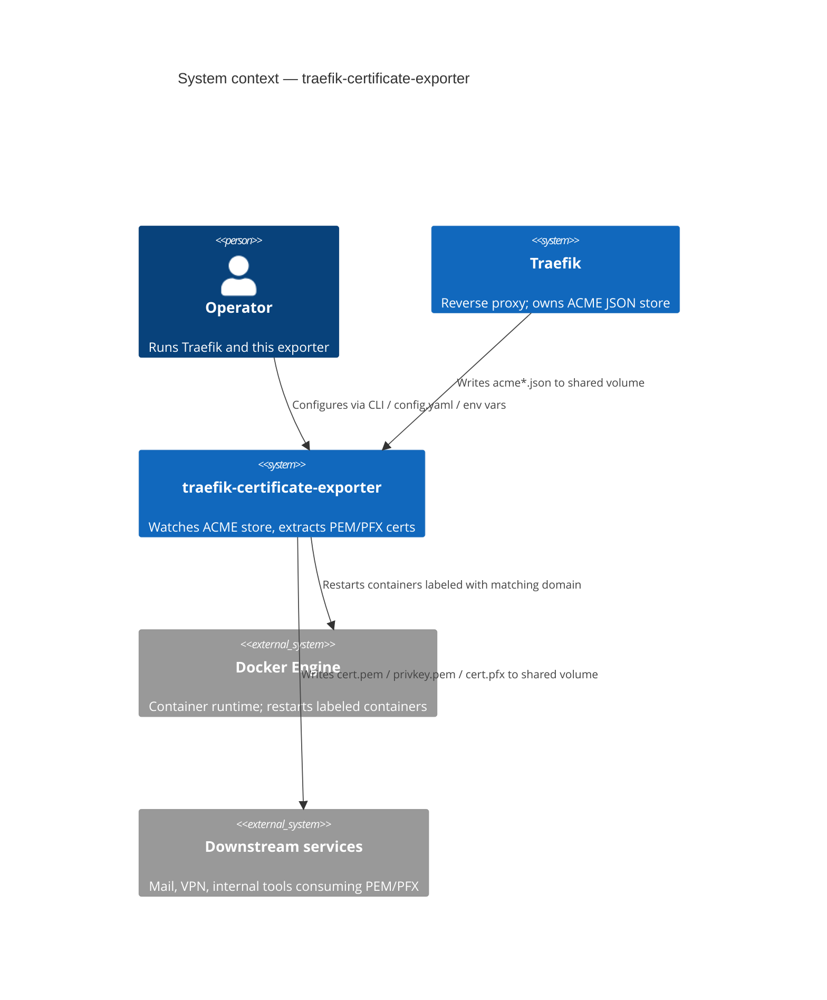
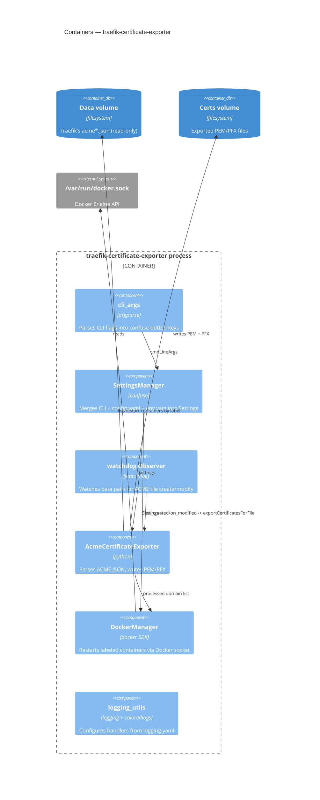
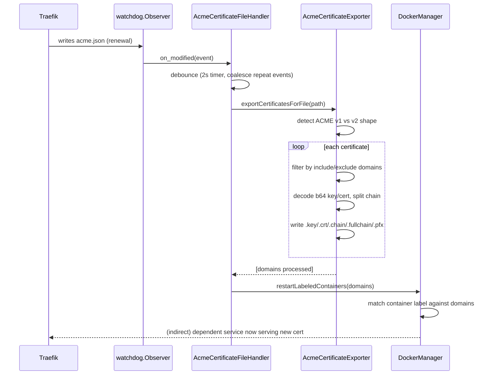

# Architecture — traefik-certificate-exporter

> Reverse-engineered from the current codebase (v0.1.3) per `l3io-arch-review` Mode A. See
> [the PRD](../_bmad-output/planning-artifacts/prds/prd-traefik-certificate-exporter-2026-08-30/prd.md) for requirements and the [review report](../_bmad-output/implementation-artifacts/review-report.md)
> for the audit that fed the ADRs and backlog referenced below. A companion
> [ARCHITECTURE-SPINE.md](../_bmad-output/planning-artifacts/architecture/architecture-traefik-certificate-exporter-2026-08-30/ARCHITECTURE-SPINE.md)
> exists as the canonical `bmad-architecture` planning artifact (terse AD-n invariants); this
> document is the fuller, diagram-first developer-facing rendering.

## 1. Context (C4 level 1)



## 2. Containers (C4 level 2)



## 3. Key flow — file change to restarted container



## 4. Deployment view

- **Distribution:** PyPI package (`pip install traefik-certificate-exporter`) or a Docker
  image built on `ghcr.io/linuxserver/baseimage-alpine:3.19` (s6-overlay init, PUID/PGID
  privilege drop — see [ADR-0002](adr/0002-container-base-image-and-privilege-model.md)).
- **Runtime:** single long-lived process per data path; no clustering, no leader election.
- **External dependencies at runtime:** filesystem (data + output volumes, read-only /
  read-write respectively), optionally `/var/run/docker.sock` if container restarts are enabled.

## 5. Known architectural gaps (tracked, not yet fixed)

See [PRD §6](../_bmad-output/planning-artifacts/prds/prd-traefik-certificate-exporter-2026-08-30/prd.md#6-fix--upgrade--enhancement-backlog) for the full, severity-ordered
backlog. The items with direct architectural shape impact:

- No observability surface (no metrics/health endpoint) — the system is a black box between
  log lines.

Two items listed here were closed and the list was not updated, which is how a "known gaps"
section stops being read. The dependency/build-artifact parity gap closed with
[ADR-0004](adr/0004-dependency-build-artifact-parity.md) in E007 — the image is built from the
locked set. "CI cannot build or publish either artifact" closed in E008: see §7 below.

## 6. Recorded decisions

One row per file in [`docs/adr/`](adr/); there is no ADR-0034. Each row's marker is read from
the ADR itself: "superseded by" from its `Status:` line, "amended by" from its
`## Amendment … ADR-NNNN` headings, its `Amended by:` line, or an "amended by" clause in its
`Status:` line. Not mechanically enforced: no check compares this table with `docs/adr/`,
so a new or re-statused ADR must update its row in the same change.

| ADR | Decision | Spine invariant |
|---|---|---|
| [0001](adr/0001-python-dependency-management-poetry.md) | Poetry for dependency/environment management | [AD-1](../_bmad-output/planning-artifacts/architecture/architecture-traefik-certificate-exporter-2026-08-30/ARCHITECTURE-SPINE.md#ad-1--poetry-is-the-single-dependency-source) |
| [0002](adr/0002-container-base-image-and-privilege-model.md) | linuxserver.io base image + PUID/PGID privilege model | [AD-2](../_bmad-output/planning-artifacts/architecture/architecture-traefik-certificate-exporter-2026-08-30/ARCHITECTURE-SPINE.md#ad-2--container-base-image-and-privilege-model) |
| [0003](adr/0003-logging-stack-and-secret-redaction.md) | Logging stack and secret-redaction policy | [AD-3](../_bmad-output/planning-artifacts/architecture/architecture-traefik-certificate-exporter-2026-08-30/ARCHITECTURE-SPINE.md#ad-3--logging-structured-file-output-secrets-never-logged) |
| [0004](adr/0004-dependency-build-artifact-parity.md) | Docker image built from the locked dependency set (amended by 0008) | [AD-4](../_bmad-output/planning-artifacts/architecture/architecture-traefik-certificate-exporter-2026-08-30/ARCHITECTURE-SPINE.md#ad-4--docker-image-built-from-the-locked-dependency-set) |
| [0005](adr/0005-ci-reusable-workflow-wiring.md) | CI reusable-workflow wiring (superseded by 0007) | [AD-5](../_bmad-output/planning-artifacts/architecture/architecture-traefik-certificate-exporter-2026-08-30/ARCHITECTURE-SPINE.md#ad-5--one-ci-pipeline-three-runners-no-act-branching) |
| [0006](adr/0006-release-version-transaction.md) | The guarded release-version transaction; identity vs. its artifacts (superseded by 0035) | — |
| [0007](adr/0007-pr-verification-topology.md) | PR-verification topology: thin event adapters, one secret-free verifier (superseded by 0035) | — |
| [0008](adr/0008-exact-wheel-image-provenance.md) | Exact-wheel provenance from the verified bundle into the image (amended by 0035) | — |
| [0009](adr/0009-action-pin-policy.md) | Action pin policy: floating major by default, reviewed SHA for credential handlers (superseded by 0035) | — |
| [0010](adr/0010-forge-release-mechanism.md) | Forge Release creation through one multi-platform action (amended by 0035) | — |
| [0011](adr/0011-publication-matrix-and-finalizer-aggregation.md) | Channel decides the destination set; how the finalizer reads a skipped job (superseded by 0035) | — |
| [0012](adr/0012-image-metadata-action.md) | The image metadata action, verified at the tag this repository pins (amended by 0035) | — |
| [0013](adr/0013-export-event-bus-and-notification-delivery.md) | One export event bus, two consumer contracts, and Apprise for delivery (superseded by 0014) | — |
| [0014](adr/0014-post-export-notifications-via-apprise.md) | Notifications on `post-export`, delivered by Apprise | — |
| [0015](adr/0015-gitea-runner-trust-class-routing.md) | Prove Gitea runner trust-class routing before enabling credentials (superseded by 0035) | — |
| [0016](adr/0016-gitea-tuple-evidence-ownership.md) | Split Gitea tuple preflight evidence from final certification evidence (superseded by scope) | — |
| [0017](adr/0017-gitea-certification-evidence-authenticity.md) | Authenticate Gitea certification evidence with retained API exports (superseded by scope) | — |
| [0018](adr/0018-tls-trust-vs-network-egress-separation.md) | Separate TLS issuer trust from network-egress authorization | — |
| [0019](adr/0019-per-job-credential-matrix.md) | Per-job credential matrix with distinct principals and denial proofs (superseded by 0035) | — |
| [0020](adr/0020-fault-injection-and-cleanup-postconditions.md) | Deterministic fault injection and cleanup postconditions for failed-jobs-only recovery (superseded by 0035) | — |
| [0021](adr/0021-forge-classifier-coordinate-contract.md) | One authoritative forge classifier and coordinate projection contract (superseded by 0035) | — |
| [0022](adr/0022-action-governance-and-release-fallback-ownership.md) | Action governance for the pinned tuple, and release-fallback ownership (superseded by 0035) | — |
| [0023](adr/0023-export-pipeline-correlation-id-and-atomic-writes.md) | Per-drain correlation ID and atomic certificate writes | — |
| [0024](adr/0024-atomic-write-helper-covers-pkcs12-exports.md) | Atomic-write helper covers PKCS12 (`.pfx`) exports, not just PEM text files | — |
| [0025](adr/0025-strict-cli-parse-without-import-time-regression.md) | Keep a lenient import-time `globalArgs`; add a separate strict parse called only from `main()` | — |
| [0026](adr/0026-none-safe-timer-cancellation-on-shutdown.md) | `AcmeCertificateFileHandler` owns a None-safe `shutdown()`/`cancel()` method | — |
| [0027](adr/0027-vendored-tree-framing-lives-in-codeowners.md) | Vendored-tree "not maintained by us" framing lives only in CODEOWNERS, not `docs/guidelines.md` | — |
| [0028](adr/0028-ref-free-checkout-across-ci-cd.md) | Ref-free checkout across all CI/CD workflows | — |
| [0029](adr/0029-ci-gate-placement-sequencing.md) | Governance gates land in verify-build.yaml; Story 3 lands before Story 2 (superseded by 0035) | — |
| [0030](adr/0030-conditional-privilege-drop.md) | Conditional root — privilege drop unless the Docker-socket restart path is enabled | — |
| [0031](adr/0031-every-external-action-pinned-to-a-reviewed-commit.md) | Every external action is pinned to a reviewed commit (superseded by 0035) | — |
| [0032](adr/0032-vendored-trees-have-a-repository-side-integrity-record.md) | The vendored tool trees have a repository-side integrity record (superseded by 0035) | — |
| [0033](adr/0033-secret-scanning-exempts-no-path.md) | Secret scanning exempts no path, and the untracked-file gate has two severities (amended by 0035; amended by 0037) | — |
| [0035](adr/0035-standard-ci-cd-pipeline.md) | A standard, trigger-selected CI/CD pipeline replaces the governed pipeline (amended by 0036) | [CI/CD spine](../_bmad-output/planning-artifacts/architecture/architecture-ci-cd-pipeline-2026-10-08/ARCHITECTURE-SPINE.md) |
| [0036](adr/0036-ci-cd-pipeline-arch-gate-amendments.md) | CI/CD pipeline amendments from the E013 architecture gate | [CI/CD spine](../_bmad-output/planning-artifacts/architecture/architecture-ci-cd-pipeline-2026-10-08/ARCHITECTURE-SPINE.md) |
| [0037](adr/0037-gitleaks-default-allowlist-is-inherited.md) | Secret scanning inherits gitleaks' default allowlist; the repository adds no path exemption | [CI/CD spine](../_bmad-output/planning-artifacts/architecture/architecture-ci-cd-pipeline-2026-10-08/ARCHITECTURE-SPINE.md) |
| [0038](adr/0038-release-only-from-protected-tags-on-main.md) | Release only from protected `v*` tags on the default branch: tag protection is the control, the ancestry check guards against mistakes | [CI/CD spine](../_bmad-output/planning-artifacts/architecture/architecture-ci-cd-pipeline-2026-10-08/ARCHITECTURE-SPINE.md) |

The ADR is the durable, full-rationale record (Context/Options/Decision/Consequences); the
spine's AD-n block is the terse, enforceable restatement `bmad-architecture`-driven work
checks against. Neither supersedes the other — update both if a decision changes.

## 7. Delivery topology (ADR-0035)

Four workflow files, chosen by trigger ([ADR-0035](adr/0035-standard-ci-cd-pipeline.md),
AD-1). `ci.yaml`, `dev.yaml` and `release.yaml` own events; `build.yaml` is reusable, owns
none, and holds no credential (AD-2). It is the only place the project is checked, tested,
built and versioned; every publish job sits downstream of it and receives its `dist`
artifact and its `version` / `image-version` outputs.

```text
 trigger              workflow       pipeline
 -------              --------       --------
 pull_request    -->  ci.yaml        build
 push to main    -->  dev.yaml       build --> publish-package (dev)
                                           --> publish-image   (dev)
 tag vX.Y.Z      -->  release.yaml   validate-tag --> build --> publish-package (release)
                                                            --> publish-image   (release)
                                                            --> release (notes + assets)

 dependency direction:  ci/dev/release.yaml --calls--> build.yaml
                        publish jobs --needs--> build (artifact `dist`, outputs version + image-version)
                        build.yaml holds no credential and calls nothing that does
```

Each destination is enabled only by its own `PUBLISH_*` secret (AD-9), each image tag has
exactly one writing workflow (AD-8), and `dev.yaml`'s `cancel-in-progress` concurrency keeps
an older dev run from moving `dev` after a newer one (AD-14). The full walkthrough, with the
destination table, is [ci/pipeline-walkthrough.md](ci/pipeline-walkthrough.md).
