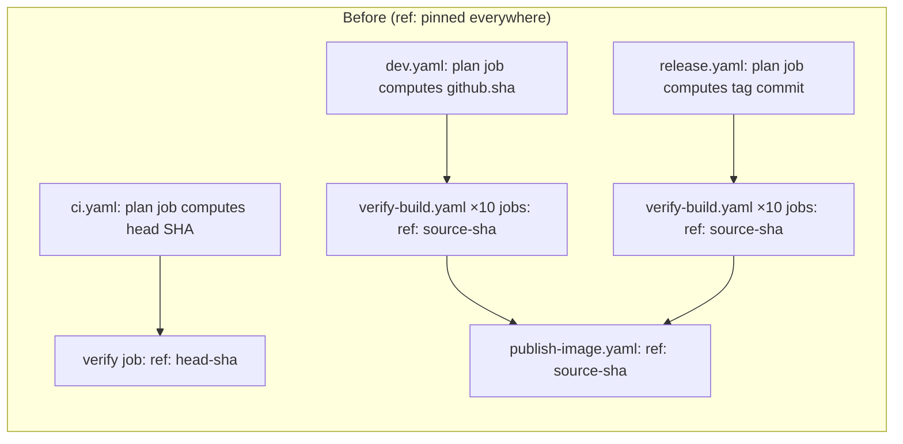
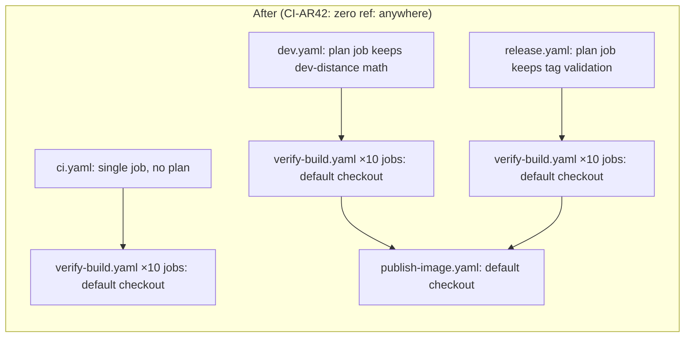

# Walkthrough: ref-free checkout across CI/CD

> **Historical — describes the pipeline retired by ADR-0035.** The ref-free checkout rule
> itself is carried forward (ADR-0028, AD-6) and every checkout in the current workflows is
> still ref-free. The workflows, jobs and rules this walkthrough names around it no longer
> exist; the current pipeline is described in
> [pipeline-walkthrough.md](pipeline-walkthrough.md) and
> [ADR-0035](../adr/0035-standard-ci-cd-pipeline.md).

**Companion to:** [`ADR-0028`](../adr/0028-ref-free-checkout-across-ci-cd.md) and
[`ARCHITECTURE-SPINE.md`](../../_bmad-output/planning-artifacts/architecture/architecture-ci-cd-pipeline-2026-08-31/ARCHITECTURE-SPINE.md)
(`CI-AR42`–`CI-AR46`).

This document walks through *why* every `actions/checkout` step in this pipeline lost its `ref:`
input, and what changed as a result. It's written for a future contributor (including a future
you) who finds a workflow file with a plain, unparameterized checkout step and wants to know why
it's not pinned to anything.

## The failure that triggered this

Running `just test-local` (which drives `docker/act-build.sh`, a disposable-clone wrapper around
`act`) against an unpushed commit reliably **deleted the disposable clone's working tree**. The
symptom, verbatim from `act`'s log:

```text
Deleting the contents of '/path/to/disposable-clone'
Initializing the repository
git init '/path/to/disposable-clone'
...
fatal: remote error: upload-pack: not our ref <sha>
```

That's `actions/checkout`'s own "ensure pristine checkout" logic: it reconstructs the remote URL
it expects from the step's `repository`/`server-url` inputs, compares that against the git
directory's actually-recorded origin, and on any mismatch wipes and reinitializes the directory
before attempting a real network fetch. This is the same mechanism behind an earlier
(2026-09-01) destructive-checkout incident — reproduced safely in disposable `/tmp` sandboxes
while investigating this, never against the real repository.

## Why this repo hit it and others didn't

Three other local, `act`-based repositories never passed `ref:` to any checkout step, so they
never triggered this path. This repository's `verify-build.yaml` is a reusable `workflow_call`
whose `source-integrity` job asserted `git rev-parse HEAD == $SOURCE_SHA` — to make that assertion
meaningful, every caller computed a source SHA up front and threaded it into **every** job's
checkout step as `ref: <source-sha>`. That's what made this pipeline the outlier.

It turns out the one place that genuinely needed an override was `ci.yaml`'s pull-request path:
GitHub's default `pull_request` checkout target is a synthetic merge-with-base commit
(`refs/pull/N/merge`), not the PR's actual head SHA — so `ci.yaml` pinned
`ref: github.event.pull_request.head.sha` to test the real head commit. Everywhere else, the
pinned commit and the default-checkout commit were already identical; the override was pure
duplication.

The only genuine no-op path for local verification belongs to `act` itself (not to
`actions/checkout`): `act` has a built-in special case that skips a checkout step entirely,
*but only when the step's `with:` block has no `ref:` key at all*. Re-confirmed empirically,
side-by-side, in a disposable sandbox:

| Step | `ref:` present? | Result |
| --- | --- | --- |
| `checkout with ref` | yes | Real `actions/checkout` JS runs, deletes the workspace, fails to fetch the unpushed SHA from the real remote |
| `checkout without ref` | no | Skipped entirely via a plain file copy, in under 40ms |

Same result for `actions/checkout@v4` and `@v7`.

## What changed





| Area | Before | After |
| --- | --- | --- |
| Checkout inputs, all 5 workflow files | `ref:`/`repository:` pinned at every site | plain `actions/checkout@v7`, ambient event context only (**CI-AR42**) |
| `ci.yaml` | 2 jobs (`plan` computes PR head SHA, `verify` calls `verify-build.yaml`) | 1 job, calls `verify-build.yaml` with only `channel: ci` (**CI-AR45**) |
| PR verification target | pinned PR head SHA | GitHub's default synthetic merge-with-base commit (**CI-AR43**, accepted trade-off below) |
| `verify-build.yaml` inputs | `source-sha` required, `package-version` required | `source-sha` removed (self-discovered via `git rev-parse HEAD`); `package-version` optional (**CI-AR44**) |
| `dev.yaml`/`release.yaml` internals | every downstream job re-pinned `ref: needs.plan.outputs.source-sha` | `plan` jobs keep their real work (version math, tag validation); downstream jobs use default checkout (**CI-AR46**) |
| `source-sha`/`package-version` as *data* (not a checkout ref) | asserted against a pre-supplied value | still flows downstream unchanged, into `publish-image.yaml` and every destination job's `expected-source-sha`/`expected-package-version` boundary-revalidation check (**CI-AR36**, unaffected) |
| `docker/act-build.sh` | load-bearing workaround for the destructive-checkout failure | retained as cheap defense-in-depth only; no longer load-bearing — every job now hits `act`'s no-op path unconditionally |

## What this does *not* change

- **CI-AR36 boundary revalidation** (every publisher re-checks `SHA256SUMS`, `build-manifest.json`,
  and source/version match before publishing) is untouched. `source-sha` and `package-version`
  still flow as plain data into `publish-image.yaml` and every destination job's assertion step —
  only their use as a *checkout* pin is gone.
- **CI-AR11 stable agreement** (tag/committed-version/package-metadata/lock/application-version
  must all match) was untouched by this change. *(2026-10-09: retired by ADR-0035. There is no
  committed version any more; the version comes only from the tag (AD-7), and `release.yaml`'s
  `publish-package` refuses a built version that is not the pushed tag's.)*
- **CI-AR33 safe local `act`** (disposable clone, synthetic inputs, never touches the developer
  worktree) still held at the time. *(2026-10-09: retired by ADR-0035, together with the
  wrapper script that implemented it. `just act` runs `act` directly against the working tree;
  ref-free checkout is what makes that safe.)*

## The second thing that changed, found during implementation

`dev.yaml`'s `finalize-dev-alias` job carried the one `ref:` that was neither
`github.sha` nor a planned source SHA: `ref: github.event.repository.default_branch`. It
existed to re-read the protected branch head *at alias time*, so the step after it
(`recheck-head`) could refuse to move `dev` onto a candidate a later push had already
superseded. `CI-AR42` removes it along with every other `ref:`, and also forbids the
`git fetch`/`git checkout` route that would reproduce it — so that checkout now resolves
to the run's own immutable `github.sha`, and the comparison below it can no longer
observe a superseding push.

What survives, and what does not:

- **Gone:** the just-in-time staleness proof. `recheck-head` is kept as defense-in-depth
  against a future change to how `source-sha` is derived, not as a freshness check.
  Concurrency (`cancel-in-progress: true`) remains the primary protection against a
  superseded candidate, as it always was — the head re-read was the backstop for the
  window where cancellation has not landed yet.
- **Gone with it:** the "refuse an empty default branch" step that guarded
  `actions/checkout`'s silent fallback when `github.event.repository.default_branch` is
  unset. There is no `ref:` left for an empty value to be substituted into.
- **Unaffected:** the stable-tag re-check in the same job. It reads the tag set *this*
  clone fetched, and the clone still happens immediately before the alias moves, so its
  freshness never depended on the `ref:`.

- **Reworded, so the audit trail stays honest:** the step name and its
  `GITHUB_STEP_SUMMARY` line claimed the candidate "is still the default-branch head".
  They now say only that the candidate matches the commit this job checked out, and name
  themselves a consistency check rather than a freshness proof. A tautology that prints a
  strong claim is worse than one that prints nothing.

This was not named in ADR-0028's per-workflow consequences (which enumerate
`stable-tag-guard`, `attest`, and the two reusable-workflow calls); it is recorded here
and in the sprint's issue list so that restoring an equivalent, ref-free just-in-time
proof can be scoped deliberately rather than rediscovered.

**Update (2026-10-09, ADR-0035; disposition of BL-E012-009).** `finalize-dev-alias` no
longer exists: the governed pipeline was replaced by four workflows, and `dev.yaml` now
moves `dev` from its `publish-image` job with no separate finalizer and no head re-check.
AD-14's `concurrency: { group: dev, cancel-in-progress: true }` is the sole protection
against a superseded dev run moving `dev`. No ref-free just-in-time proof is restored; that
is accepted by AD-14. Concurrency acts only on runs still in progress: a manual re-run of a
superseded dev run after a newer one has finished is not covered, and moves `dev` back to
the older commit (the CI recovery runbook in `docs/operational.md` forbids it).

## The trade-off we accepted

Because `ci.yaml` no longer pins a PR's head SHA, and GitHub recomputes the synthetic merge ref on
demand, two independently-checked-out jobs in the same long-running PR verification run could — in
a narrow, specific scenario — see different merge results if the base branch (`main`) moves between
one job's checkout and another's. A single-checkout-plus-artifact-fan-out design would close this
gap entirely, but was deliberately **not built**: the risk is narrow (requires a `main` push racing
a single in-flight PR run) and well understood, and simplicity won out. See `CI-AR43` and
ADR-0028's Consequences section for the full reasoning.

## If you're about to reintroduce a `ref:`

Stop and ask: is the commit you want to check out actually different from the one the triggering
event already points at? For `push`/tag-triggered workflows, it almost certainly isn't —
`github.sha` is immutable for the life of the run. If you've found a genuine exception (not
just "I want to be extra sure"), that's a new `AD` in the spine, not a quiet `with: ref:` line —
and watch for the indirect routes `CI-AR42` also forbids: a `git fetch`/`git checkout <sha>` shell
step after a ref-free checkout has exactly the same effect and is just as disallowed.
